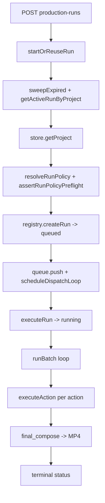

# P26 Production Workflow Recon

Status: RECON ONLY. No application code, tests, schema, config, or dependencies
were changed. No commits, no pushes, no paid API calls, and no real
image/video/TTS/music generation was performed. All findings below are derived
by reading this repository (source of truth), by running existing local tests and
safe local commands, and from the evidence already on disk (`p18`, `p20`, `p24`,
`p25.1`).

Evidence tags used throughout:

- **Verified** — observed by running an existing test or a safe local command
  (no credentials, no external/paid calls).
- **Code-inspected** — established by reading the implementation; logic is
  deterministic but not executed end-to-end here.
- **Unverified** — plausible but not proven by evidence gathered in this pass.
- **Potential risk** — a concrete defect or failure mode that follows from the
  code; may need a controlled local reproduction to fully confirm.

Baseline for this recon:

- Git branch `main`, HEAD `99bb6190130d69f324188875a47a0450a175d6ba` (P25/P25.1).
- Working tree clean except the existing untracked recon reports.
- Environment probe (existence only, values never read or printed):
  `OPENAI_API_KEY=SET`, `ELEVENLABS_API_KEY=UNSET`,
  `PRODUCTION_RUN_ALLOW_REAL_PROVIDERS=UNSET`, `PRODUCTION_RUN_DEFAULT_MODE=UNSET`.

---

## 1. Executive summary

The production workflow is a single-machine, in-process pipeline that turns a
project (scenes + assets + narration + optional music) into a rendered MP4. It
is end-to-end functional **in mock mode** (P18 drove a real decodable 1280x720
H.264/AAC MP4 with the `fake` providers; P19/P25 verified real FFmpeg scene
render + composition).

What is real vs. mocked today:

- **Real**: FFmpeg scene rendering, composition/concatenation, channel
  normalization and peak limiting (P25/P25.1), ffprobe, project persistence,
  run lifecycle, image editing via `sharp`, and the OpenAI Images adapter,
  ElevenLabs TTS + music adapters (network code present, gated).
- **Mocked by default**: image generation (`fake`), text-to-speech (`fake`),
  background music (`fake`), video generation (`local`).
- **Effectively disabled in this environment**: real-provider mode is denied at
  the policy layer because `PRODUCTION_RUN_ALLOW_REAL_PROVIDERS` is unset
  (`lib/production/run-policy.ts:79-88,152-161`), so runs are always `mock`.

The run subsystem is an **in-memory registry backed by best-effort JSON
persistence**. Runs survive a process restart only via a lazy, constructor-time
recovery pass. This is adequate for the current single-process deployment but has
several concrete reliability gaps (Section 4):

1. **Concurrent double-start race** in `startOrReuseRun` — the "reuse active run"
   check and the create are separated by an `await`, so two near-simultaneous
   requests can both create a run for the same project.
2. **Run can get stuck in `running`** — `executeRun` sets status `running` before
   reading the project, and the project read is **outside** the `try`; a thrown
   read error rejects the worker promise (unhandled) and leaves the run
   permanently `running`.
3. **Fatal abort on transient refresh** — if `refreshProject` returns `null`
   mid-run, a `RunServiceError(NOT_FOUND)` is thrown and the whole run fails,
   even though the project may reappear.
4. **`partial` result status is effectively unreachable** in the common path —
   a failed action is re-planned with status `failed`, which is counted as
   "unresolved", so the runner returns `failed` before `partial` is ever hit.
5. **Lazy recovery** — `recoverRuns()` is fired from the constructor
   (`run-service.ts:247-249`), not at a true process-startup hook.

MP4 acceptance today is **structural, not perceptual**: the pipeline verifies
existence/duration/codec (ffprobe) and the P25.1 tests assert sample-peak and
zero clipped samples, but there is no end-to-end "the rendered file is playable
and within loudness bounds" gate wired into the run itself (Section 5).

For Hermes/MCP self-service (Section 6), the repository exposes **one** stdio MCP
server (`explainer-local-mcp`) with **14 tools** across three groups
(6 read-only, 5 authoring, 3 production) — enough for an agent to create a
project, plan, run production, and poll status/logs without touching the HTTP
API directly.

Recommended next phase (Section 8): a **small, test-covered production-run
robustness fix** targeting items 1–3 (atomic start-or-reuse, always-terminal run
status, and resilient refresh), rather than a broad rewrite. It is the smallest
change that removes real, user-visible failure modes.

---

## 2. Current production flow

### 2.1 Entry points

- **Start a run**: `POST /api/projects/[id]/production-runs`
  (`app/api/projects/[id]/production-runs/route.ts:34`) → `runService.startOrReuseRun`.
  Returns `202` for a new run, `200` when an active run is reused.
- **Poll a run**: `GET /api/production-runs/[runId]`
  (`app/api/production-runs/[runId]/route.ts:11-20`).
- **Read the log**: `GET /api/production-runs/[runId]/log`
  (`app/api/production-runs/[runId]/log/route.ts:22-60`).
- **Plan preview**: `GET /api/projects/[id]/production-plan`
  (`app/api/projects/[id]/production-plan/route.ts:11-16`).
- **Clients**: browser `lib/client/production-run-client.ts:86-96`; tracker
  `lib/client/production-run-tracker.ts:90-112,245-301`; MCP
  `mcp/production/api-client.ts:191`.

### 2.2 Lifecycle

**Code-inspected** — `startOrReuseRun` (`run-service.ts:252-306`), dispatch loop
(`run-service.ts:555-570`), `executeRun` (`run-service.ts:572-680`).

### 2.3 Planned actions

The planner derives a dependency-ordered action set
(`lib/production/production-planner.ts`):

| Action type | Purpose | Provider path |
| --- | --- | --- |
| `image_generate` | scene still image | `fake` (default) / `openai` |
| `video_submit` | submit async video job | `local` (default) / `openai` |
| `video_poll` | poll async video job | matches submit provider |
| `narration_generate` | per-scene narration TTS | `fake` (default) / `elevenlabs` |
| `scene_render` | FFmpeg render scene clip | FFmpeg (real) |
| `final_compose` | concat + mix → MP4 | FFmpeg (real) |

**Code-inspected** — action builders at `production-planner.ts:180,232,247,304,367,428`.

### 2.4 Data and storage

- Project tree: `projects/<projectId>/{project.json,assets,references,renders,
  previews,runs}`. Runs are persisted as `projects/<projectId>/runs/<runId>.json`.
- `getWorkspaceRoot()` resolves to `process.cwd()`.
- **Code-inspected** — `lib/storage/storage-paths.ts`, `lib/production/run-store.ts`.

---

## 3. Provider / mock matrix

### 3.1 Environment (existence only)

| Variable | State | Effect |
| --- | --- | --- |
| `OPENAI_API_KEY` | SET | OpenAI image/video adapters *could* run if policy allowed |
| `ELEVENLABS_API_KEY` | UNSET | ElevenLabs TTS/music cannot authenticate |
| `PRODUCTION_RUN_ALLOW_REAL_PROVIDERS` | UNSET (=false) | Real mode denied |
| `PRODUCTION_RUN_DEFAULT_MODE` | UNSET (=mock) | Default mode forced to `mock` |

**Verified** — safe existence probe (no values printed).

### 3.2 Policy resolution

`resolveRunPolicyServerConfig()` (`run-policy.ts:79-88`) computes
`defaultMode = allowRealProviders ? requestedDefaultMode : 'mock'`. With
`allowRealProviders=false`, the default is always `mock` and any explicit
`mode: 'real'` request is rejected with `POLICY_DENIED` (403)
(`run-policy.ts:152-161,216-219`). Mock mode additionally rejects any non
fake/local provider (`run-policy.ts:205-214`). **Code-inspected**.

### 3.3 Provider defaults per mode

| Provider slot | mock default | real default | Implementations |
| --- | --- | --- | --- |
| image | `fake` | `openai` | `fake` (sharp PNG 1280x720), `openai` Images API |
| video | `local` | `openai` | `local`, `openai` |
| narration | `fake` | `elevenlabs` | `fake` (real WAV, P23), `elevenlabs` |
| music | `fake` | `elevenlabs` | `fake`, `elevenlabs` |

**Code-inspected** — `resolveProviderDefaults` (`run-policy.ts:90-106`).

### 3.4 Real-call feasibility here

- **Real image**: blocked by policy (real mode denied despite `OPENAI_API_KEY`
  being set). Image model defaults to `gpt-image-1` via `OPENAI_IMAGE_MODEL`;
  missing key would surface as `409 provider.notConfigured`.
  **Code-inspected / Unverified** (no paid call made).
- **Real TTS/music**: additionally blocked by missing `ELEVENLABS_API_KEY`.
- **Net**: no real external provider call is demonstrably possible in this
  environment as configured. **Verified by config inspection only** — not by an
  actual provider invocation.

---

## 4. Reliability and recovery

### 4.1 Persistence model

- Single-process `InMemoryRunRegistry` (`lib/production/run-registry.ts`) is the
  source of truth during a run.
- `FileRunStore` (`run-store.ts`) writes an atomic envelope (temp file +
  `rename`, `run-store.ts:82-85`) and reads best-effort: parse failures and
  missing dirs are swallowed (`run-store.ts:47-58,92-94,100-104`). **Persistence
  failures are explicitly non-fatal** (`run-service.ts:439-443`). **Code-inspected**.
- Debounced persistence via `schedulePersist`/`flushRun` (`run-service.ts:407-453`).

### 4.2 Recovery

`recoverRuns()` (`run-service.ts:332-381`) re-imports persisted runs, then for any
`queued`/`running` entry not already recovered, re-enqueues or supersedes it.
Duplicate projects are collapsed (later runs marked `failed`/`run_superseded`,
`run-service.ts:360-371`). It is **idempotent** via `recoveredRunIds`.

**Potential risk** — recovery is triggered lazily from the constructor
(`run-service.ts:247-249`, `void this.recoverRuns()`), not a real startup hook.
If the service module is never imported in a fresh process, no recovery happens;
and the constructor's fire-and-forget swallows errors (`.catch(() => {})`).

### 4.3 Concrete failure modes

**R1 — Concurrent double-start race.** `startOrReuseRun`
(`run-service.ts:252-306`) checks `getActiveRunByProject` (line 260), then
`await store.getProject` (line 268, a yield point), then `registry.createRun`
(line 293). Two requests arriving together can both pass the active check before
either creates, producing two runs for one project. **Potential risk**,
**Code-inspected**.

**R2 — Run stuck in `running`.** `executeRun` sets status `running` at line 574,
then reads the project at line 581 **outside** the `try`. If `getProject`
throws (I/O error), the worker promise rejects; the dispatch loop only attaches
`.finally` (`run-service.ts:565`), not `.catch`, so the rejection is unhandled
and the run never reaches a terminal status — it stays `running` in the registry
and in the persisted JSON. **Potential risk**, **Code-inspected**. (The `null`
case at lines 582-592 is handled correctly; only the *throw* path is not.)

**R3 — Fatal abort on transient refresh.** `refreshProject`
(`run-service.ts:627-635`) throws `RunServiceError(NOT_FOUND)` when the project
momentarily reads as `null`. The outer `catch` (lines 667-679) then marks the
whole run `failed`. A transient read failure aborts an otherwise-recoverable run.
**Potential risk**, **Code-inspected**.

**R4 — `partial` status effectively unreachable.** `determineResultStatus`
(`production-runner.ts:208-219`) returns `partial` only when
`unresolvedActions.length === 0 && failedCount > 0`. But the planner re-marks a
previously failed action with status `failed`
(`production-planner.ts:157-158,209-210,250-251,272-273,328-329,397-398`), and
`unresolvedActions` filters out only `current`/`skipped`
(`production-runner.ts:504,536`). So a failed action keeps `unresolvedActions`
non-empty and the runner returns `failed` (line 215-216). `partial` is reachable
only if a failed action disappears from the replanned set.
**Potential risk**, **Code-inspected**.

**R5 — No network timeouts on real providers.** The real adapters are gated off
here, but their fetch paths carry no explicit request timeout. **Unverified** —
not exercised; flagged for when real mode is enabled.

---

## 5. MP4 acceptance and verification

### 5.1 What is verified today

- **Structural**: the pipeline renders scene clips and composes a decodable
  H.264/AAC MP4; ffprobe is used to read duration/codec. P18/P19 evidence on disk
  confirms a real 1280x720 MP4. **Verified (existing evidence)**.
- **Audio correctness (P25/P25.1)**: `tests/video-compositor-audio.integration.test.ts`
  asserts channel-layout normalization (mono+stereo → stereo) and peak limiting
  (`alimiter=limit=0.95:level=false` with `level=false` to avoid FFmpeg
  auto-level re-scaling), including adversarial narration-only and
  narration+music (volume 4) cases, checking f32 sample-peak and zero clipped
  samples. **Verified by test**.

### 5.2 Gaps

- There is **no automated acceptance gate wired into the run** that asserts the
  final MP4 is within a loudness/peak bound or that it decodes without error;
  P25.1's assertions live in tests, not in the production path. **Code-inspected**.
- `effectsVolume` is parsed (`lib/constants.ts`, default 0.2) but never applied
  (carried over from P20/P24). **Code-inspected**.
- No perceptual (listen) verification was performed in this pass; no listening
  claims are made.

---

## 6. Hermes / MCP self-service assessment

### 6.1 Topology

- **Exactly one** MCP server process: `explainer-local-mcp`
  (`mcp/read-only/server.ts:8-25`), `StdioServerTransport`.
- It composes three tool groups: read-only, authoring, production
  (`server.ts:21-23`). npm scripts: `mcp:readonly` / `mcp:local` (aliases),
  `test:mcp`, `test:mcp:readonly`.

### 6.2 Tools (14 total)

| Group | Count | Tools |
| --- | --- | --- |
| read-only | 6 | `list_projects`, `get_project`, `get_scene`, `get_validation_report`, `get_production_plan`, `get_project_compositions` |
| authoring | 5 | `create_project`, `update_project`, `plan_scene_intents`, `materialize_scene_intents`, `manage_project_music` |
| production | 3 | `run_production`, `get_run_status`, `get_run_log` |

**Verified** — enumerated from `mcp/*/tools.ts` and `server.ts`.

### 6.3 Self-service viability

An MCP client can create a project, plan/materialize scenes, manage music, then
`run_production` and poll `get_run_status`/`get_run_log` without the HTTP API.
`p11.4-hermes-mcp-e2e.ts` wraps `scripts/p11.4-hermes-mcp-e2e.ts` as an E2E
harness. **Code-inspected**. Gaps inherited from Section 4 apply equally to the
MCP-driven path (same underlying service).

---

## 7. Prioritized next phases

| # | Phase | Effort | Value | Basis |
| --- | --- | --- | --- | --- |
| 1 | Make `startOrReuseRun` atomic (R1) | S | High | pre-existing duplicate runs |
| 2 | Guarantee terminal run status on project-read throw (R2) | S | High | stuck `running` runs |
| 3 | Make `refreshProject` resilient to transient null (R3) | S | Medium | avoidable run failure |
| 4 | Reconcile `determineResultStatus`/planner for `partial` (R4) | S | Low | correctness/dead branch |
| 5 | Move recovery to a real startup hook (R4.2) | S | Medium | reliability on restart |
| 6 | Add run-level MP4 acceptance gate (peak/decode) (Section 5) | M | Medium | prevents silent regression |
| 7 | Apply `effectsVolume` (Section 5.2) | S | Low | dead config surfaced |
| 8 | Add real-provider network timeouts (R5) | S | Low* | only when real mode enabled |

(*) value is deferred: real mode is disabled in this environment.

---

## 8. Recommendation

Do **one** small, test-covered phase: **production-run lifecycle robustness
(items 1–3, R1–R3)**. Rationale:

- These are the only findings that produce user-visible, hard-to-diagnose
  failures (silent duplicate runs, permanently stuck `running` runs, avoidable
  full-run aborts) under the *current* mock-mode deployment.
- They are localised to `lib/production/run-service.ts` and are independently
  unit-testable with the existing in-memory registry and a temp `FileRunStore`,
  so no paid calls or real providers are required.
- Items 4–8 are lower value now (dead branch, config-only, or gated behind
  disabled real mode) and should be deferred or folded in opportunistically.

A broader rewrite of the run subsystem is **not** justified by current evidence.

---

## 9. Controls, limitations, and open questions

Controls honored: recon only; no product code/tests/schema/config/dependency
changes; no commits or pushes; no paid or real provider calls; existing untracked
reports preserved; provider env vars inspected for existence only (values never
read or printed).

Limitations:

- No end-to-end run was executed in this pass; Sections 2–4 rest on
  code inspection plus pre-existing P18/P19/P24/P25.1 evidence.
- Race conditions R1/R2 are reasoned from the `await` boundaries, not from a
  forced-concurrency reproduction.
- Real-provider behavior (Section 3.4, R5) is unverified because real mode is
  denied and ElevenLabs has no key.

Open questions:

1. Is there any deployment-level startup hook that imports the run service
   eagerly? If not, lazy recovery (4.2) may never fire after a restart.
2. Should a transient project-read `null` during a run retry with backoff rather
   than fail (R3)?
3. Is `partial` intended to be a first-class status, or is it vestigial (R4)?
