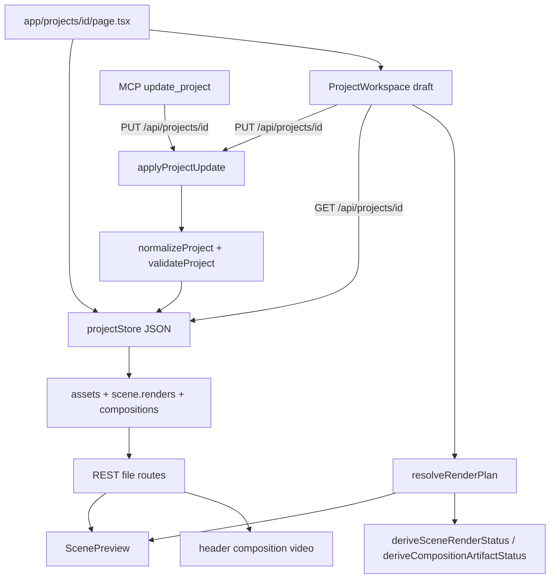

# P301 · Workspace-shell Recon

Recon only. Geen productiecode gewijzigd, geen commit, geen push, geen betaalde provider-calls.

Inspectiedatum: 2026-10-26. Branch: `261021-feat-motion-canvas-animation-mcp`.

Methode: code-inspectie van projectpagina, scènemodel, preview, renderplan, compositie en MCP/REST-pad; bestaande niet-destructieve tests gedraaid.

Bestaande tests (niet-destructief): `tests/scene-preview.test.tsx`, `tests/render-status.test.ts`, `tests/p32.1-scene-timing.test.ts`, `tests/workspace-controls.test.tsx`, `tests/p31.3-stale-composition.test.ts` — 5 files, 52 passed.

Oordeel: **direct implementeerbaar** voor een workspace-shell (layout + navigatie + afgeleide tijdlijn). Geen datamodel-uitbreiding nodig. Geen architectuurblokkade. Studio-getrouwe live preview en een echte globale MP4-seek zonder eindrender vallen buiten de kleinste shell.

---

## 1. Huidige component- en dataflow

### 1.1 Route

`app/projects/[id]/page.tsx` is een server component. Het laadt identiteit via `getServerIdentity`, haalt het project op via `getProjectForIdentity`, en rendert alleen `<ProjectWorkspace project={project} />`. Geen workspace-layout op de pagina zelf.

### 1.2 Controller

`components/project/project-workspace.tsx` (~4570 regels, `'use client'`) is de enige client-entry voor de projectpagina. Het houdt een lokale `draft: Project` kopie bij. Selectie, tabs, save, render, compose, productie en inspectie leven hier.

P46 (`p46-workspace-decomposition-recon.md`) beschreef dit bestand al als maintainability-bottleneck. Sindsdien is het verder gegroeid (destijds ~2684 regels). Dat is geen blokkade voor P301, wel een reden om de shell als nieuwe layout-laag te bouwen in plaats van nóg meer JSX in dezelfde file te duwen.

### 1.3 Huidige UI-indeling

Boven naar beneden:

1. **Header** — projecttitel, beschrijving, duration/fps/aspect, knoppen (Add scene, Save, Render Scene, Compose, Open Render, Open Final Video), save/render/compose-berichten, optionele `<video>` van de laatste compositie, render-readinesskaarten.
2. **ProductionWorkflow** — stappenbriefing met navigatie naar tabs.
3. **Production-sectie** — Produce-ready, log, `AgentMandatePanel`, `ServerRunPanel`.
4. **Tabs** — Story / Scenes / Assets / References / Generation Tasks.
5. **Scenes-tab** — drie kolommen: verticale scènelijst (280px) | `ScenePreview` | scene inspector (~400px).
6. **ValidationPanel**.

Er is geen vorige/volgende-scèneknop, geen horizontaal scènelint, geen globale seek-balk, geen persistente speelpositie.

### 1.4 Dataflow



Bron van waarheid op schijf: `projects/{id}/project.json` plus asset-/render-/compositiebestanden. UI en MCP schrijven hetzelfde document via `PUT /api/projects/{id}` → `applyProjectUpdate` → `projectStore.mutateProject`.

MCP `update_project` vervangt `project.scenes` wholesale. UI-mutaties blijven in `draft` tot Save. Productie/generatie/refresh overschrijft `draft` met de serverkopie (`refreshProject`).

### 1.5 Laden van scènes, assets, composities, runs, MP4

| Entiteit | Waar | Hoe de UI het ziet |
| --- | --- | --- |
| Scènes | `project.scenes[]` (order, duration, visual, narration, overlay, composition, renders) | lokale `draft`, `selectedSceneId` |
| Assets | `project.assets[]` + `localPath` | `/api/projects/{id}/assets/{assetId}/file` of `joinProjectFileUrl` |
| Scene-render MP4 | `scene.renders[]` | `/api/projects/{id}/renders/{renderId}/file` |
| Eind-MP4 | `project.compositions[0]` | `/api/projects/{id}/compositions/{compositionId}/file` |
| Runs | aparte run-store, niet in project.json | `ServerRunPanel` / production REST |
| Preview (niet-MP4) | bronasset + CSS-motion + overlay-benadering | `ScenePreview` |

Runs horen niet in het scènemodel. QC/downloadPath van P210 blijft productiecontract; de workspace-shell hoeft runs niet te spiegelen.

---

## 2. Relevante bestanden en herbruikbare componenten

### 2.1 Kernbestanden

| Bestand | Rol |
| --- | --- |
| `app/projects/[id]/page.tsx` | server route; ongewijzigd laten |
| `components/project/project-workspace.tsx` | controller + huidige layout |
| `components/preview/scene-preview.tsx` | scènepreview (bron + overlay + optionele scene-MP4) |
| `components/project/workspace-controls.tsx` | `TabButton`, `Field`, `SelectField`, `InfoMiniCard`, `EmptyPanel` |
| `lib/types/scene.ts` | Scene, narration, overlay, visual, renders |
| `lib/types/render.ts` | Project, RenderPlan, CompositionArtifact/Plan |
| `lib/types/scene-composition.ts` | studio-lagen (niet in preview) |
| `lib/render/scene-resolver.ts` | `resolveRenderPlan`, `resolveRenderPlanDurationSeconds` |
| `lib/render/scene-timing.ts` | effectieve scèneduur (authored vs narration) |
| `lib/render/render-status.ts` | scene render lifecycle + composition missing/current/stale |
| `lib/render/video-composition-service.ts` | concat-plan; `totalDuration`; presenter `startTime` |
| `lib/projects/project-update.ts` | UI/MCP-schrijfpad |
| `mcp/authoring/tools.ts` | `update_project` |
| `app/api/projects/[id]/route.ts` | GET/PUT project |
| `app/api/projects/[id]/renders/[renderId]/file/route.ts` | scene-MP4 |
| `app/api/projects/[id]/compositions/[compositionId]/file/route.ts` | eind-MP4 |

### 2.2 Herbruikbaar zonder modelwijziging

- `selectedSceneId` + `setSelectedSceneId` — scène selecteren bestaat al.
- Verticale scènelijst — dezelfde data, andere presentatie (lint).
- `ScenePreview` — grote preview van de geselecteerde scène.
- Header-titel + `saveMessage` — bovenbalk-naam en opslagstatus.
- `resolveRenderPlan` / `resolveRenderPlanDurationSeconds` — scèneduur en totale tijd.
- `deriveSceneRenderStatus` / `deriveCompositionArtifactStatus` — missing/stale/current.
- Bestaande `<video controls>` voor scene-render en eindcompositie.
- Inspectorvelden (duration, narration, overlay, media) — later editorpaneel.
- `workspace-controls` primitives.

### 2.3 Niet herbruikbaar als globale player

- Geen dedicated video-playercomponent, geen timeline-component, geen thumbnail-generator.
- `ScenePreview` toont geen studio-lagen, presenter, logo of Motion Canvas-overlay. Het zegt expliciet: browserpreview, niet de finale MP4.
- Header-compositievideo is een losse `<video controls>` zonder koppeling aan `selectedSceneId`.
- Compositor is `concat`, geen xfade. `scene.render.transition` zit in het scènemodel en in scene-renders; de globale balk mag niet doen alsof overgangen de globale tijdas verschuiven.

---

## 3. Scènemodel: beschikbaar vs ontbrekend

Niets toevoegen. Onderstaande is af te leiden of ontbreekt bewust.

### 3.1 Beschikbaar

| Behoefte | Bron | Opmerking |
| --- | --- | --- |
| Volgorde | `scene.order` | lijst wordt al gesorteerd |
| Duur (authored) | `scene.duration` | inspector bewerkbaar |
| Duur (effectief) | `RenderPlanScene.duration` / `timing.effectiveDuration` | groeit mee met narration + 0.25s padding |
| Geselecteerde scène | `selectedSceneId` | alleen client state |
| Voice-over tekst | `scene.narration.text` | productiecopy per scène |
| Voice-over audio | `scene.narration.audioAssetId` + asset | aparte `<audio>` in preview |
| Woordtiming | `scene.narration.alignment` | karaoke; niet nodig voor shell |
| Tekstlagen | `scene.overlay` | type/text/position/style/timing |
| Beeld/video | `scene.visual` + `project.assets` | asset / generated / stock / graphic / html / text / blank |
| Animatie | `scene.composition.layers` (studio-screen / overlay) | niet zichtbaar in `ScenePreview` |
| Compositie | `scene.composition` + project `compositions[0]` | per-scène lagen vs eind-MP4 |
| Overgang | `scene.render.transition` | `none` / `fade` / `crossfade`; duur optioneel |
| Previewmedia | bronasset-URL of placeholder | CSS-motion, geen FFmpeg |
| Gerenderde scène | `scene.renders[]` completed MP4 | stale wordt niet afgespeeld |
| Eindvideo | `compositions[0]` + file route | fingerprint bepaalt current/stale |
| Totale duur | `resolveRenderPlanDurationSeconds(plan)` | autoritatieve planningstijdlijn |
| Stale/missing | `deriveSceneRenderStatus`, `deriveCompositionArtifactStatus` | al in UI |

### 3.2 Ontbrekend (niet toevoegen in P301)

| Gat | Gevolg voor de shell |
| --- | --- |
| Geen `scene.title` / `scene.label` | Toon `Scene {order}` + `type`; optioneel overlay- of narration-snippet. Intent-labels leven in `explainer.sceneIntents`, niet op Scene. |
| Geen thumbnail-asset | Lint kan still-asset, html-png of een CSS-poster gebruiken; geen gegarandeerde first-frame van video zonder extra werk. |
| Geen persistente `selectedSceneId` | Herladen opent altijd scène 1. Acceptabel voor v1. |
| Geen persistente playhead | Speelpositie is sessie-lokaal. |
| Geen globale start/end op Scene | Afleiden: cumulatieve som van `renderPlan.scenes` in order. |
| Geen seek-helper time→scene | Pure functie over het renderplan; geen API nodig. |
| `ScenePreview` mist studio-compositie | Grote preview is authoring-preview, niet WYSIWYG-studio. Getrouwe weergave = scene-render MP4 of eind-MP4. |
| Geen autosave / dirty-flag | `saveMessage` wordt leeggemaakt bij draft-wijziging, maar er is geen "unsaved"-indicator en geen debounce-save. |
| Eind-MP4 ontbreekt of is stale | Globale balk kan plannen (click → select scene) maar niet betrouwbaar de echte file seeken. |

---

## 4. Voorgestelde workspace-indeling

Kleinste uitbreiding: **Scenes-tab ombouwen tot workspace-shell**. Story/Assets/References/Generation en production-header blijven. Geen tweede projectmodel.

```text
+------------------------------------------------------------------+
| Topbar: title (draft.title) | save status | Save                 |
+------------------------------------------------------------------+
|                                                                  |
|              Grote preview (bestaande ScenePreview,              |
|              of scene-MP4 als current)                           |
|                                                                  |
|         [ Prev ]                               [ Next ]          |
+------------------------------------------------------------------+
|  Scènelint:  [sc1] [sc2] [sc3] [sc4]  →  (horizontaal, ~3-4)    |
+------------------------------------------------------------------+
|  Globale balk |------|======|--------|--------|  time / total    |
+------------------------------------------------------------------+
|  Editorpaneel (bestaande inspector: tekst, VO, media, timing)    |
+------------------------------------------------------------------+
```

### 4.1 Direct mogelijk

- Topbar met `draft.title` en save-status uit bestaande `saveMessage` + explciete Save.
- Grote preview: bestaande `ScenePreview` (of een compacte variant zonder dubbele inspector-summary).
- Prev/next: index in gesorteerde `draft.scenes`; wrap of disable aan de randen.
- Scènelint: dezelfde scene-knoppen horizontaal, `overflow-x: auto`, actieve scène gescrolld in beeld. ~3–4 zichtbaar is CSS (`minmax` / vaste thumb-breedte), geen virtuele lijst nodig voor typische 3–12 scènes.
- Editorpaneel: huidige inspector verplaatsen onder of naast de preview.
- Globale balk als **plan-navigator**: click fraction → time → scene via cumulatieve `renderPlan` durations; zet `selectedSceneId` en optioneel een lokale `sceneLocalTime`.
- Missing/stale eindrender: balk blijft klikbaar op de plantijdlijn; toon `missing` / `stale` / `current` uit `deriveCompositionArtifactStatus`. Geen fake MP4.

### 4.2 Aanvullende infrastructuur (niet voor de kleinste shell)

- Echte globale playback van de eind-MP4 (`video.currentTime = t`) alleen als status `current`.
- Scrubben door scene-renders aan elkaar (meerdere `<video>` of MediaSource) als er geen eind-MP4 is.
- Studio-getrouwe live preview (lagen, presenter, animatie).
- Thumbnails uit video-frames.
- Autosave.
- Persistente selectie/playhead.
- Drag-and-drop tijdlijn, keyframes, AI-overgangen — expliciet buiten P301.

### 4.3 Preview versus eindvideo

Twee verschillende dingen, niet mengen:

1. **Authoring preview** (`ScenePreview`): huidige draft, bronmedia, CSS-motion, overlay-benadering, aparte narration-audio. Werkt zonder render.
2. **Rendered preview**: scene-MP4 als fingerprint current; anders waarschuwing "stale" of "not rendered".
3. **Final video**: concat van scene-MP4s + audio mix + optionele presenter overlay. Alleen betrouwbaar als `deriveCompositionArtifactStatus.status === 'current'`.

Globale balk:

- Tijd → scène is altijd mogelijk op het **renderplan** (`resolveRenderPlan`).
- Tijd → pixels in een afspelende MP4 alleen als die MP4 bij dat plan hoort.
- Plan-duur en artifact-duur kunnen een fractie verschillen (fps/container). Seek mag `sceneDurationMatches`-tolerantie (0.15s / 2 frames) gebruiken, niet een nieuwe waarheid verzinnen.

Overgangen: compositor concateneert segmenten. Een click op 5.0s is scène N op lokale t = 5.0 − start(N). Fade in de scene-render zit ín dat segment, niet tussen globale slots.

---

## 5. UX en state

### 5.1 Eén bron van waarheid

| Staat | Waar | Persist? |
| --- | --- | --- |
| Projectinhoud | `draft` tot Save, daarna `project.json` | ja, na Save/MCP |
| Geselecteerde scène | `selectedSceneId` | nee |
| Afspeelpositie | nieuw, sessie-lokaal | nee |
| Save-feedback | `saveMessage` | nee |
| Render/compositie-status | afgeleid van `draft` + fingerprints | ja, via artifacts |

Geen tweede project-store. Playhead en selectie zijn view-state bovenop `draft`.

### 5.2 Navigatie

- Lint / prev / next / globale balk schrijven alleen `selectedSceneId` (en optioneel local time).
- Wijzigingen in de inspector schrijven `draft` via bestaande `updateScene` / `updateProject`.
- Save = bestaande `PUT`. Reload = server project, selectie valt terug naar scène 1.
- MCP `update_project` terwijl de UI unsaved draft heeft: conflict bestaat nu al. Shell mag dat niet verergeren. Productiepaden doen al `saveProject` vóór run en `refreshProject` erna.

### 5.3 Autosave

Geen autosave. Save is handmatig. `updateProject` wist `saveMessage`, maar toont geen "unsaved". Kleinste shell: topbar-status `Saved` / `Unsaved` door `draft` te vergelijken met laatste succesvolle save-kopie, zonder debounce-PUT. Autosave later, niet in P301-minimum.

### 5.4 Fout- en laadstatus

Bestaand hergebruiken: `saveMessage`, render/compose messages, `deriveSceneRenderStatus.problems`, composition stale reasons, `ValidationPanel`. Geen parallelle statusmachine.

Als de geselecteerde scène verdwijnt (MCP vervangt `scenes`), valt de huidige code al terug op `draft.scenes[0]`. Behouden.

---

## 6. Gaten, risico's, scope

### 6.1 Kleinste werkbare wijziging

1. Pure helper: `buildWorkspaceTimeline(renderPlan)` → `{ totalDuration, scenes: [{ sceneId, order, start, end, duration }] }`.
2. Pure helper: `resolveTimeToScene(timeline, time)` → `{ sceneId, localTime }`.
3. Scenes-tab layout: preview + prev/next + horizontaal lint + plan-balk + inspector.
4. Topbar-save-status op de bestaande header of een compacte shell-balk.
5. Globale balk: click zet selectie; als eind-MP4 `current` is, optioneel `video.currentTime`. Zonder MP4 geen playback, wel navigatie.
6. Tests voor helper + lint/selectie (SSR of pure). Geen MCP/productiecontract wijzigen.

### 6.2 API's/services ongewijzigd

- Project GET/PUT, MCP `update_project` / `get_project`.
- Render/compose/file routes.
- `resolveRenderPlan`, fingerprints, QC, mandates, spend caps.
- Production runner.

### 6.3 Architectuurproblemen — geen blokkade

- `ProjectWorkspace` is te groot. Mitigatie: nieuwe presentational componenten (`workspace-shell`, `scene-lint`, `program-bar`) i.p.v. meer monolith-JSX. Geen verplicht voorafgaand P46-extract.
- `ScenePreview` is geen studio-compositor. Shell mag dat niet verbergen: label "browser preview" houden; rendered MP4 apart.
- Unsaved draft vs MCP blijft een bestaand risico; shell introduceert het niet.
- Geen jsdom/@testing-library; `ProjectWorkspace` zelf wordt niet gerenderd in tests. Test de helpers puur en nieuwe leaves via `renderToStaticMarkup`, plus eventueel source-guards zoals overlay-tests.

### 6.4 Buiten P301

- Vrije drag-and-drop-tijdlijn
- Keyframes
- Volledige compositie-editor
- AI-overgangsgeneratie
- Dummy-narration / betaalde preview-renders
- Autosave naar disk
- Persistente playhead
- Studio-live-preview van alle lagen

---

## 7. Testplan en acceptatiecriteria

### 7.1 Bestaand (regressie, nu groen)

- `tests/scene-preview.test.tsx` — overlay/preview blijft werken.
- `tests/render-status.test.ts` / `tests/p31.3-stale-composition.test.ts` — missing/stale/current.
- `tests/p32.1-scene-timing.test.ts` — effectieve duur / compose-plan.
- `tests/workspace-controls.test.tsx` — primitives.
- Bestaande production/MCP-tests niet aanraken.

### 7.2 Nieuw (bij implementatie, niet in deze recon)

| Case | Eis |
| --- | --- |
| Selectie | click lint-item zet actieve scène; inspector/preview volgen dezelfde id |
| Prev/next | volgorde `scene.order`; eerste/laatste disabled of no-op |
| Lint overflow | >4 scènes: horizontale overflow, actieve scène blijft programmatisch in beeld |
| time → scène | t=0 → eerste; t net voor einde scène N → N; t=total → laatste; t buiten bereik clamp |
| Effectieve duur | timeline gebruikt renderplan-duur, niet alleen `scene.duration` |
| Save/reload | Save PUT ongewijzigd; na reload inhoud van server, selectie default eerste scène |
| Unsaved indicator | wijziging wist saved-status; succesvolle save toont saved |
| Geen eindrender | balk zichtbaar, click selecteert scène, geen crash, status `missing` |
| Stale eindrender | balk mag plannen; niet doen alsof de oude MP4 current is; status `stale` + bestaande reason |
| Current eindrender | optionele seek op dezelfde file-URL als nu |
| Geen regressie | MCP `update_project`, `run_production`, file download, QC-report ongewijzigd |

Geen betaalde submits in tests. Geen nieuwe provider-calls.

### 7.3 Acceptatie voor de latere implementatie

- Eén projectpagina, één `draft`.
- Scène wisselen zonder tab te verlaten.
- ~3–4 thumbs zichtbaar, rest via horizontale scroll.
- Click op globale balk landt in de juiste scène op basis van het renderplan.
- Ontbrekende of verouderde eind-MP4 blokkeert navigatie niet.
- Save blijft handmatig en schrijft hetzelfde PUT-contract.

---

## 8. Implementatiestappen (logische volgorde, niet uitvoeren)

1. Extraheer `buildWorkspaceTimeline` + `resolveTimeToScene` naast `resolveRenderPlanDurationSeconds` (pure, getest).
2. Presentational: horizontaal scènelint + prev/next, gevoed door bestaande scenes + `selectedSceneId`.
3. Herorden scenes-tab: preview boven, lint, balk, inspector. Geen nieuwe data.
4. Compacte topbar-status (`title` + saved/unsaved) zonder autosave.
5. Program-bar: click → time → scene. Toon total uit renderplan. Badge missing/stale/current.
6. Optioneel: als composition `current`, bind één `<video>` `currentTime`. Niet verplicht voor shell-v1.
7. Tests uit §7.2. Geen MCP/API-wijziging.

---

## 9. Oordeel

**direct implementeerbaar**

Onderbouwing:

- Scènevolgorde, selectie, preview, inspector, save en file-URLs bestaan.
- Totale tijd en per-scène effectieve duur zijn al de autoritatieve tijdlijn (`resolveRenderPlan`).
- Missing/stale/current voor scene-renders en eind-MP4 is al afgeleid en getest.
- UI en MCP delen hetzelfde projectdocument; de shell is view-state.
- Ontbrekende titels/thumbnails/autosave/studio-WYSIWYG zijn display-keuzes, geen modelblokkades.

Niet "eerst blokkade oplossen": `ProjectWorkspace`-omvang is een risico, geen blocker, mits nieuwe leaves in plaats van nog meer controller-JSX.

Niet "meer recon nodig": preview-vs-MP4, time→scene en unsaved-draft zijn uit code vastgelegd.

Einde recon. Geen implementatie.
