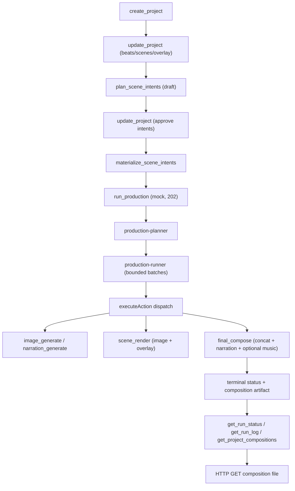

# P31 End-to-End Production Workflow Recon

Status: RECON ONLY. No application code, tests, schema, config, dependencies,
MCP tools or UI were changed. No commits or pushes. No paid provider calls and
no credentials were read, logged or verified by real requests. Existing tracked
files and all untracked recon reports were preserved.

Baseline: branch `main`, HEAD `8174b21` (clean working tree apart from the two
untracked overlay recon reports `p29-text-overlays-kinetic-typography-recon.md`
and `p29.2-text-overlay-authoring-recon.md`).

Evidence tags used below: **Verified by test**, **Live-proven (paid run)**,
**Code-inspected**, **Unverified**, **Potential risk**.

Goal: map the explainer production workflow from project/script to a fully
rendered MP4 (generated image + text overlays + voice-over + music), identify
what still blocks a reliable, repeatable end-to-end result, and recommend the
next implementation phase.

---

## 1. Executive summary and verdict

The pipeline is **functionally complete and genuinely end-to-end in mock mode**
for the *default/blank* scene shape, but **not automatically proven for the full
explainer shape** (generated image + overlay + narration + music) and **not ready
for a real-provider full run**.

What is real vs mocked vs missing today:

- **Real (FFmpeg)**: scene render, overlay burn-in, composition/concatenation,
  peak-limiting + forced-stereo audio pass, ffprobe validation, project
  persistence, run lifecycle, image editing (`sharp`).
- **Real adapters, gated off in this environment**: OpenAI Images (live-proven in
  P29), ElevenLabs TTS (live-proven in P30), ElevenLabs music (tests only), OpenAI
  video (never tested). All gated by provider policy defaulting to `mock`
  (`lib/production/run-policy.ts:82-91`).
- **Mocked by default**: image (`fake`), narration (`fake`), music (`fake`),
  video (`local`).
- **Missing / excluded from runs**: music is **not a production-run action**, so a
  run never produces background music — it must be generated and selected
  separately *before* `final_compose`, or the final MP4 has no music
  (`lib/production/run-policy.ts:258-260`; no music branch in the runner dispatch
  `lib/production/run-service.ts:776-986`). `effectsVolume`/SFX is parsed but never
  applied.
- **Broken in mock mode**: the fake video provider emits a 24-byte non-decodable
  MP4 stub (`lib/ai/video-generation/fake-provider.ts:15`), so a video-visual
  scene cannot be rendered in mock mode.

Headline gaps, ranked:

1. **No automated test drives the real executors through a full production run to
   a final MP4.** Every run-service test injects a mocked `runBatch`
   (`tests/production-run-service.test.ts:108`, `tests/production-run-lifecycle.test.ts:163`,
   `tests/run-recovery.test.ts:328`, `tests/text-overlay-authoring.test.ts:236`).
   Renderer and composition tests run in isolation, not as a run.
2. **The one time the full chain reached an MP4 (P18) it used a `blank` scene** —
   the `image_generate` action was never part of that run, so image→render→overlay
   inside a run is unproven.
3. **Music is outside the run**; an agent calling `run_production` gets no music.
4. **Video path**: unverified real adapter + non-decodable mock output.
5. **Audio duration authority mismatch** (P24 defect 3) remains: narration is
   validated against `scene.duration` but trimmed to `render.duration`.

Verdict: the next highest-value, lowest-risk phase is a **deterministic mock-mode
end-to-end production-run test** that exercises a *generated_image* scene (image →
overlay burn-in → narration → final compose), asserts a decodable MP4, and pins
the overlay/audio invariants — see §8. Closing the music-in-run gap and hardening
the video path follow.

---

## 2. End-to-end workflow map

### 2.1 Lifecycle

### 2.2 Planned actions

The planner emits exactly six action types; there is **no music action and no
overlay action** (`lib/production/production-planner.ts:8-14`):

| Action type | Builder | Executed by (`run-service.ts`) | Provider |
| --- | --- | --- | --- |
| `image_generate` | `production-planner.ts:150-199` | `generateSceneImage` (`:797-801`) | `fake` / `openai` |
| `video_submit` | `:201-250` | `submitSceneVideoGeneration` (`:834-838`) | `local` / `openai` |
| `video_poll` | `:252-266` | `refreshVideoGenerationAttempt` (`:872`) | matches submit |
| `narration_generate` | `:269-326` | `generateSceneNarration` (`:906-910`) | `fake` / `elevenlabs` |
| `scene_render` | `:328-388` | `sceneRenderService.renderScene` (`:942`) | FFmpeg (real) |
| `final_compose` | `:391-447` | `videoCompositionService.composeProject` (`:967`) | FFmpeg (real) |

Execution order is fixed: scenes by `order`, then
`image_generate → video_submit → video_poll → narration_generate → scene_render
→ final_compose` (`production-planner.ts:449-456`, mirrored by
`production-runner.ts:414`). Actions are `ready` only when built with
`execute: true` at status `ready`; `deriveReadyProductionActions` filters them
(`:464-466`).

### 2.3 Where each output is produced

- **Image** — `image_generate` → `lib/generation/image-generation-service.ts` →
  media store (`projects/<id>/assets/scene-NN-generated-*.png`).
- **Overlay** — not an action. `scene_render` re-reads the project;
  `resolveRenderPlan` copies `overlay: scene.overlay` into the plan
  (`lib/render/scene-resolver.ts:171`), and the renderer turns it into a
  `drawtext=...:textfile=...` filter appended to the still/video chain
  (`lib/render/renderer.ts:331-336`). `text`-kind scenes skip the overlay to avoid
  duplication (`lib/render/text-overlay.ts:113-116`).
- **Voice-over** — `narration_generate` writes an audio asset; it is **not muxed
  at scene render** (stills are video-only). Narration is attached at composition:
  `resolveCompositionPlan` resolves `resolveNarrationAudioPath`
  (`lib/render/video-composition-service.ts:105-130`) and the compositor selects
  narration as the segment's audio track in place of embedded audio
  (`lib/render/video-compositor.ts:66-75`).
- **Music** — generated out-of-band (`lib/generation/music-service.ts`), selected
  onto `project.music.assetId`. Composition mixes it only if selected
  (`video-composition-service.ts:135-158`; `video-compositor.ts:183-232`); a
  missing/invalid track degrades to no music.
- **Final MP4** — `renders/compositions/final-<compositionId>.mp4` plus a metadata
  JSON (`lib/render/composition-artifacts.ts:22-33`).

### 2.4 Storage and entry points

- Project tree: `projects/<projectId>/{project.json,assets,references,renders,
  previews,runs}`; `getWorkspaceRoot()` = `process.cwd()`.
- Production routes: `POST /api/projects/[id]/production-runs` (start/reuse),
  `GET /api/production-runs/[runId]` (status), `GET /api/production-runs/[runId]/log`,
  `GET /api/projects/[id]/production-plan`, `POST /api/projects/[id]/compose`,
  `POST /api/projects/[id]/render` (first scene only), per-scene render route,
  render/composition file-download routes. Raw file route allow-list is
  `assets, references, renders, previews` — **not** `compositions`
  (`app/api/projects/[id]/files/[...path]/route.ts:16`); compositions have their
  own download route.

---

## 3. Data-chain consistency findings

- **Narration duration authority mismatch (P24 defect 3, still present).**
  Narration acceptance compares `asset.duration <= scene.duration + 0.01`
  (`video-composition-service.ts:121`; `narration-service.ts` scene-fit). Segment
  length/trim uses `render.duration` → `item.duration`
  (`video-composition-service.ts:185`; `video-compositor.ts:269`). When
  `render.duration < scene.duration`, an accepted narration is silently trimmed.
  **Verified (local, P24 s7); not re-run in this pass.**
- **Audio safety improved since P24.** The compositor now forces stereo
  (`SEGMENT_CHANNEL_LAYOUT_FILTER`) and applies `alimiter` on the no-music concat
  path as well as the music-mix path (`lib/render/video-compositor.ts:18,244`;
  commit `99bb619`). P24 defects 1–2 are addressed. **Code-inspected; covered by
  `tests/video-compositor-audio.integration.test.ts` (Verified).**
- **Overlay parity.** The renderer and the browser preview share
  `lib/render/overlay-resolve.ts` (P29.3), so defaults/clamps/colors agree between
  what the user sees and what is burned in. Overlay `style`/`timing` are validated
  and the full `scene.overlay` is part of the render fingerprint, so editing an
  overlay marks a completed render `stale` and re-schedules `scene_render`.
  **Code-inspected.**
- **Music identity in staleness.** The composition artifact status compares a music
  fingerprint (`lib/render/render-status.ts:254-257`), so changing/clearing music
  correctly invalidates a composition. **Code-inspected.**
- **`effectsVolume`/SFX is dead**: parsed (default 0.2) but never applied; no SFX
  asset type flows into the mix. **Code-inspected.**

---

## 4. Reliability and recovery

- **Run lifecycle hardened in P27** (commit `a1b661e`): `startOrReuseRun`
  coalesces concurrent starts via `pendingStarts`; the initial project read moved
  inside the `try` so a thrown read yields a terminal `failed`; `refreshProject`
  uses a bounded `readProjectWithRetry` (`lib/production/run-service.ts:87,271-309,
  629-652`). Covered by `tests/production-run-lifecycle.test.ts` (Verified).
- **Recovery**: `recoverRuns` rehydrates persisted runs, supersedes duplicate
  active runs, reconciles interrupted generations
  (`lib/production/run-recovery.ts:43-195`), and is idempotent. Triggered lazily
  from the service constructor (P26 open question remains): a fresh process that
  never imports the service performs no recovery.
- **Persistence**: atomic temp+rename with per-project write lock; persistence
  failures are non-fatal (`lib/production/run-store.ts:82-85`).
- **`partial` status remains effectively unreachable** (P26 R4, left as-is in P27
  §R4): the planner re-marks failed actions `failed`, which counts as unresolved,
  so the runner returns `failed` before `partial`. **Code-inspected.**
- **Real-provider recovery is untested**: all recovery tests run in mock mode.

---

## 5. Production readiness — five questions

1. **Can a complete explainer video be produced today?**
   In mock mode, yes for blank/text scenes (P18 reached a decodable MP4,
   **Live-proven**), and image/narration/overlay/compose are each individually
   proven. A *generated-image* scene driven entirely by a run has **not** been
   proven end-to-end (P18's run used a `blank` scene; plan showed only
   `narration_generate` + `scene_render`). Real providers are off by policy.

2. **Is there a proven, automated end-to-end test?**
   **No.** No test wires the real action executors through `runProductionBatch`
   to a final MP4 (§7). The manual harness `scripts/p11.4-hermes-mcp-e2e.ts` drives
   MCP against a live dev server but is not part of `vitest`/CI.

3. **How many manual steps to a real video?**
   Real image (P29) and real narration (P30) each required a dedicated
   double-confirmed env flag, a throwaway key, and a bespoke `scripts/real-*-pilot.ts`
   runner. A real full run additionally needs `PRODUCTION_RUN_ALLOW_REAL_PROVIDERS`,
   all four real providers (incl. the unverified video adapter), and a pre-selected
   music asset. Music remains a separate manual step.

4. **Real-provider vs mock coverage?**
   Mock: broad (unit/integration for every service, render, compose, lifecycle).
   Real: OpenAI image **live-proven** once (P29); ElevenLabs narration
   **live-proven** once (P30); ElevenLabs music adapter **mock-HTTP only**;
   OpenAI video **zero tests / unverified contract** (`sora-1`,
   `/videos/generations`, `lib/ai/video-generation/openai-provider.ts:59`).

5. **What is needed for a 1–5 minute video?**
   Multi-scene runs exist but no test drives >1 scene end-to-end. Risks for longer
   videos: `maxIterations` (24) and per-action caps (`production-runner.ts:120-130`),
   video poll ceilings, the duration-authority mismatch (§3), and composition
   duration tolerance (`±max(0.35, 1/fps)`). A long real video also multiplies the
   unverified-video-adapter and cost risks.

---

## 6. UX improvements (max 5)

Observed in `components/project/project-workspace.tsx` and the production flow:

1. **Show the composed-music state at compose time.** The workspace lets a user
   start a run and get a music-less MP4 with no visible warning that music is not
   part of the run. Surface "music will/will not be included" next to the run
   button and offer a one-click "generate + select music" before composing.
2. **Surface run blockers before starting.** `get_production_plan` already reports
   `blocked`/`waiting_dependency`; the UI should list why `final_compose` is
   waiting (e.g. stale render, missing narration) instead of only failing at run
   time.
3. **Per-scene overlay discoverability.** Overlay controls exist, but `text`-kind
   scenes silently ignore the overlay (`text-overlay.ts:113-116`); disable/grey
   the overlay panel for text scenes with an inline explanation.
4. **Render staleness affordance.** Because any overlay edit flips a render to
   `stale`, show a per-scene "re-render needed" badge and a "re-render stale
   scenes" action rather than relying on the next full run.
5. **Mock video warning.** A video-visual scene in mock mode cannot render
   (24-byte stub). Warn when a `generated_video` scene is planned under `mock`
   before the user starts a run.

---

## 7. Test coverage inventory

| Layer | Representative files | Covers | Style |
| --- | --- | --- | --- |
| Planner | `tests/production-planner.test.ts` | gating, force, stale/blocked, dependencies | fast unit |
| Runner | `tests/production-runner.test.ts` | bounded batches, failure isolation, events | fake `executeAction` |
| Run service / lifecycle | `tests/production-run-service.test.ts`, `tests/production-run-lifecycle.test.ts`, `tests/run-recovery.test.ts` | reuse, coalescing, recovery, retries | **mocked `runBatch`** |
| Policy | `tests/run-policy.test.ts` | mock/real enforcement, pilot widening | fast unit |
| Render (real FFmpeg) | `tests/local-ffmpeg-renderer.test.ts`, `tests/fake-image-provider-render.test.ts`, `tests/scene-render-concurrency.test.ts` | scene MP4, temp-dir isolation | isolated, real ffmpeg |
| Overlay (real FFmpeg) | `tests/text-overlay-render.integration.test.ts`, `tests/text-overlay-authoring-render.integration.test.ts` | drawtext burn-in, escaping, temp lifecycle; narrations muxed by a **raw ffmpeg command**, not the renderer | isolated, real ffmpeg |
| Composition (real FFmpeg) | `tests/video-composition-service.integration.test.ts`, `tests/video-compositor-audio.integration.test.ts`, `tests/video-composition-plan.test.ts`, `tests/video-compositor-args.test.ts` | concat + narration + music, limiter/stereo, error paths | isolated, real ffmpeg |
| Audio/mix | `tests/audio-mix.test.ts`, `tests/music-mix.test.ts` | volume clamps, fades, signatures | fast unit |
| Pilots | `tests/real-image-pilot.test.ts`, `tests/real-narration-pilot.test.ts` | gated one-scene real chain, render | mock HTTP + real ffmpeg |
| MCP | `tests/mcp-production.test.ts`, `tests/mcp-compositions.test.ts` | tool/client wrappers | mock HTTP |
| Manual E2E | `scripts/p11.4-hermes-mcp-e2e.ts` | MCP-only create→run→download vs live dev server | **manual, not in CI** |

**Missing coverage (the core P31 gap):** there is **no** automated test that runs
`startOrReuseRun`/`runProductionBatch` with the **real** executors
(`generateSceneImage` → `sceneRenderService.renderScene` → `videoCompositionService.composeProject`)
and asserts a final decodable MP4. The closest labeled "mock E2E"
(`tests/text-overlay-authoring.test.ts:178-304`) mocks both `runBatch` and
`renderScene` and writes no MP4.

---

## 8. Ranked next phases

Each phase is independently shippable; ordering is by value vs. risk/effort.

### Rank 1 (recommended) — Deterministic mock-mode end-to-end run test

**Why:** it is the only thing that turns "end-to-end functional in mock mode"
(P18, manual, blank scene) into an automated, repeatable gate over the *real*
executors. It also exercises the currently-unproven generated-image scene inside a
run and pins the P29.3 overlay and P25/P25.1 audio invariants. Cheap (no paid
calls), safe, and it protects every future change to planner/runner/render/compose.

**Scope (preferred brief):**

- New `tests/production-run-e2e.integration.test.ts` (real ffmpeg; skip cleanly if
  `ffmpeg` absent, matching existing integration tests).
- Build a project in a temp workspace with **two scenes**: one
  `generated_image` scene (with `overlay` text) and one `text`/`blank` scene, each
  with narration text; keep providers at mock defaults (`fake` image, `fake`
  narration, `local`/no video).
- Drive `startOrReuseRun` with the **real** `executeAction` wiring (as the
  production service does) and poll to terminal status.
- Assert: run `completed`; a scene render exists per scene;
  `composeProject` produced an artifact; `ffprobe` reports h264 video + aac audio
  and a positive duration; overlay text visibly affects the render (at minimum
  that an overlay filter was applied / render differs from no-overlay).
- Assert idempotency: a second run reuses/marks actions `current`, issues no
  duplicate generation.

**Files touched:** one new test file (plus a small test helper if needed). No
production code change required. **Acceptance:** test passes in CI and fails if
`image_generate`, overlay burn-in, narration muxing, or composition regress.
**Verification:** `npx tsc --noEmit`, `npm run lint`, `npx vitest run`.

### Rank 2 — Bring background music into the production run (opt-in)

**Why:** the user-visible promise "fully rendered MP4 with music" is not met by
`run_production` today; music is a separate manual step. This is the largest
functional gap.

**Scope sketch:** add a `music_generate` action (or a pre-compose music step)
to the planner/runner when `project.music` is absent **and** a prompt/mode is
configured, reusing the existing `music-service`; keep it explicitly opt-in and
fail-soft (a music failure must not fail the run) to avoid changing default
behavior. Update `run-policy` and tests accordingly. **Risk:** medium — new action
type touches run policy/planner/runner; must preserve deterministic termination and
the "music never blocks compose" semantics. **Defer real-provider music** (no key
here); mock `fake` music is a silent WAV, so assert track presence, not audibility.

### Rank 3 — Fix the video path (mock decodability + real adapter)

**Why:** mock-mode `generated_video` scenes cannot render (24-byte stub) and the
real OpenAI video adapter is unverified (`sora-1`, `/videos/generations`, no tests,
no timeout). This is the weakest modality.

**Scope sketch:** (a) make the fake video provider emit a tiny *valid* MP4
(e.g. a `lavfi color` clip) so mock-mode video scenes render; (b) either verify or
quarantine the OpenAI video adapter behind its own fail-closed gate until the
endpoint/model contract is confirmed, and add a bounded timeout like the P29/P30
adapters. **Risk:** low for (a)/quarantine, high for claiming (b) without a real
endpoint.

**Recommended:** ship **Rank 1 now**; treat Rank 2 and Rank 3 as the next
two scheduled phases.

---

## 9. Controls, limitations, and open questions

Controls honored: recon only; no product/test/schema/config/dependency changes;
no commits or pushes; no paid or real provider calls; no credential values read or
printed; provider env inspected for existence only in prior phases; pre-existing
untracked reports preserved.

Limitations:

- No production run was executed in this pass; Sections 2–5 rest on code
  inspection plus prior on-disk evidence (P18/P19/P24/P25.1/P27/P29/P30).
- Real-provider behavior remains proven only by the single P29/P30 pilots, not by
  an automated suite.
- No perceptual/listening verification; audio claims are structural.

Open questions:

1. Should music be a first-class run action, or intentionally remain a separate
   pre-compose step (the current design)? This decides Rank 2.
2. Is the OpenAI video adapter targeting a real, current endpoint/model, or should
   it be quarantined? This decides Rank 3.
3. Should the duration-authority mismatch (§3) be fixed by aligning composition to
   the validation authority, or surfaced as a warning?
4. Should recovery move from the lazy constructor hook to a real startup hook?

---

## 10. Git status

- Branch `main`; HEAD `8174b21` (unchanged, == `origin/main`).
- No tracked files modified; no commits or pushes.
- Untracked preserved: `p29-text-overlays-kinetic-typography-recon.md`,
  `p29.2-text-overlay-authoring-recon.md`, and this new
  `p31-end-to-end-production-workflow-recon.md`.
