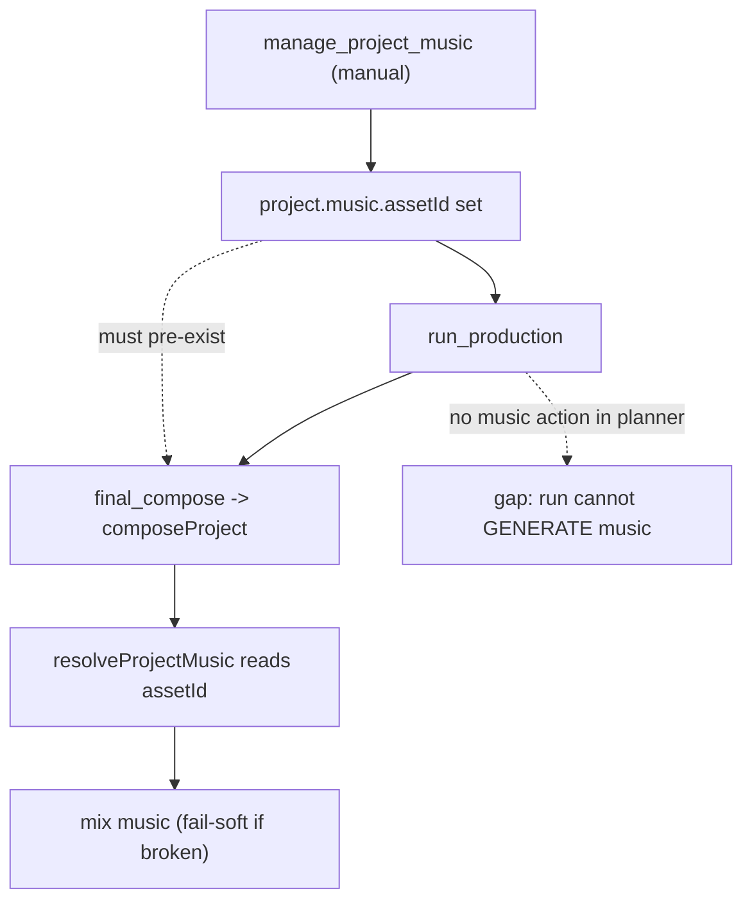

# P33 Background Music in the Production Run — Recon

Status: RECON ONLY. No application code, tests, schema, config, dependencies, MCP
tools or UI were changed. No commits or pushes. No paid provider calls; no
credentials were read, printed, logged or verified by real requests. All existing
tracked files and all untracked recon reports were preserved.

Baseline: branch `main`, HEAD `186f02c` ("test(production): add deterministic
end-to-end run integration test"). Working tree clean apart from the untracked
recon reports `p29-text-overlays-kinetic-typography-recon.md`,
`p29.2-text-overlay-authoring-recon.md`, `p31-end-to-end-production-workflow-recon.md`.

Evidence tags used below: **Verified by test**, **Code-inspected**, **Unverified**,
**Potential risk**.

Goal: determine exactly how the existing music selection/generation stack relates
to the production run, pin the true integration gap (without paid requests), and
propose the smallest safe, opt-in, fail-soft implementation with acceptance
criteria.

---

## 1. Executive summary and verdict

Background music is a **complete standalone feature** (generate / select / clear,
provider registry, real + fake adapters, duration clamp, fades, volume, loop,
mix with narration, limiter, composition fingerprinting) and it is **already
consumed by composition**. The production run does **not** add anything to that
chain — it only *inherits* whatever track is already selected on the project when
`final_compose` executes.

The real, precise gap is therefore **not** "music never reaches a run MP4" (a
correction to the P31 wording), it is:

- **Gap A — no generation/selection step inside a run.** `run_production` cannot
  create music from scratch; a headless run only *uses* a pre-existing
  `project.music.assetId`. Fully headless music requires a separate
  `manage_project_music` call **before** the run.
- **Gap B — `providers.music` is accepted but inert for runs.** The run policy
  validates and stores the music provider, then `assertRunPolicyPreflight`
  deliberately ignores it (`run-policy.ts:258-260`). No action ever uses it.
- **Gap C — status is not considered when consuming.** `resolveProjectMusic`
  keys off `project.music.assetId` only; it never checks `music.status`, so a
  `failed` or `generating` entry with a still-valid on-disk asset is mixed.

Verdict: the smallest safe phase is an **explicitly opt-in, fail-soft pre-compose
music step** that reuses `generateProjectMusic` and the existing policy resolver,
wired inside the run executor (not the shared composition service, which the
manual `/compose` route also calls). This keeps default behavior byte-for-byte
unchanged, keeps the paid-request safety model intact, and requires no new
planner action type or runner semantics change. See §6.

---

## 2. Music chain map

### 2.1 Type model (`lib/types/render.ts`)

- `ProjectMusicStatus = 'planned' | 'generating' | 'generated' | 'failed'` (`:48`).
- `ProjectMusicGenerationAttempt` (`:50-65`): per-attempt record with
  `provider`, `providerRequestId`, `mimeType`, `duration`, `audioAssetId`, times.
- `ProjectMusicSpec` (`:67-85`): optional project-wide track reference;
  `assetId`, `prompt`, `provider`, `model`, `status`, `instrumental`,
  `musicLengthMs`, `format`, `seed`, `duration`, `lastAttemptId`, `error`,
  `attempts[]`. Selecting stores only a reference; the underlying asset stays a
  normal project asset and is never implicitly deleted.
- `Project.music?: ProjectMusicSpec` (`:103`).

### 2.2 Generation service (`lib/generation/music-service.ts`)

- `generateProjectMusic(projectId, options, deps)` (`:133-365`):
  1. `activeMusicLocks` guard (`:148-152`) → `music.alreadyRunning`.
  2. Loads project; requires a non-empty `prompt` (`:162-165`).
  3. `clampMusicLengthMs` bounds the request to the provider's 3 s–10 min window
     (`:167`, via `lib/render/music-mix.ts:6-20`).
  4. Provider resolved by `resolveMusicProvider` → `resolveManualGenerationProvider('music', …)`
     (`:118-127`, `run-policy.ts:454-521`).
  5. Guards `music.alreadyGenerated` unless `regenerate` (`:179-185`) and
     `music.alreadyRunning` when status is `generating` (`:187-189`).
  6. Registers the adapter (`:191-200`), records a `generating` attempt and sets
     `music.status='generating'` (`:206-237`), calls `provider.generate(...)`
     (`:241-248`), persists via `mediaStore.saveGeneratedMusic` (`:291-307`),
     appends the asset and sets `music.status='generated'` + `assetId`
     (`:309-341`). On failure the attempt and `music.status` become `failed` and
     the error is mapped to a `ProjectMusicGenerationError` code (`:249-289`).
- `selectProjectMusic(projectId, assetId)` (`:367-403`): validates the asset is
  `music`/`audio`, then sets `music.assetId` + `status='generated'`; no request.
- `clearProjectMusic(projectId)` (`:405-422`): sets `music = undefined`; the asset
  is retained.
- Error surface `ProjectMusicGenerationError` codes (`:22-60`) incl.
  `music.provider.notConfigured` / `auth` / `rateLimited` / `rejected` / `failed`,
  `music.alreadyGenerated`, `music.invalid`, etc.

The HTTP surface is `app/api/projects/[id]/music/route.ts`: `POST` actions
`generate | regenerate | select | clear`, throttled by `enforceThrottle(identity, 'generate_music')`
(`:37`), and mapped to the same error codes.

### 2.3 Provider registry and adapters (`lib/ai/music/`)

- `provider.ts`: `MusicProvider` (`generate`), `MusicGenerationRequest`
  (`prompt`, `durationMs`, `model`, `instrumental`, `seed`, `outputFormat`),
  `MusicGenerationResult`, `MusicProviderError` codes.
- `registry.ts`: `createMusicRegistry()`; `getProvider('fake'|'local') →
  FakeMusicProvider`, `'elevenlabs' → ElevenLabsMusicProvider`. Construction of
  the ElevenLabs adapter performs **no** network call; the paid request is built
  only inside `generate()` (`registry.ts:20-24`). `getMusicConfigurationStatus()`
  reports `elevenlabsConfigured: Boolean(process.env.ELEVENLABS_API_KEY)` and the
  mode default provider.
- `elevenlabs-provider.ts`: `DEFAULT_ELEVENLABS_MUSIC_MODEL`; note it **drops
  `seed`** (`:186-187`), so real generation is not reproducible.

### 2.4 Selection, duration, fades, volume (`lib/render/music-mix.ts`)

- `isMusicAsset` accepts `music` or `audio` (`:22-24`).
- `resolveSelectedMusicAsset(project)` reads `project.music.assetId` and looks it
  up in `project.assets` (`:26-32`).
- `deriveMusicSignature(project)` builds an identity string (asset id, duration,
  generation id/provider/model/prompt) (`:36-50`) — used by the composition
  fingerprint.
- `resolveMusicFade(total)` returns deterministic in/out fades (1 s in, 2 s out),
  bounded by the output duration (`:59-65`).
- Mix settings come from `renderSettings.audio` via
  `normalizeAudioMix` (`lib/render/audio-mix.ts:25-31`); `musicVolume` is clamped
  to `[0,4]`. Default `musicVolume = 0.35` (`lib/constants.ts:63`).

### 2.5 Composition consumption (`lib/render/video-composition-service.ts`, `video-compositor.ts`)

- `resolveProjectMusic(project)` (`:135-158`): if `project.music.assetId` is
  absent, or the asset is missing / not a music asset / has no `localPath`,
  returns `undefined`. If the asset file fails the on-disk check it catches the
  `CompositionServiceError` and **degrades to no music** (fail-soft; a broken
  reference never fails an otherwise valid render).
- `resolveCompositionPlan` attaches `music?: { path, duration }` (`:194-206`).
- `buildCompositionArtifact` records music in the input fingerprint
  (`musicVolume`, fades, `musicSignature`) when both a plan track and a selected
  asset exist (`:209-251`).
- `buildMusicMixArgs` (`video-compositor.ts:183-232`): loops the track
  (`-stream_loop -1`), applies `volume`, `atrim` to the total duration, `afade`
  in/out, then `amix` with narration and `alimiter`, copying video without
  re-encoding. `mixMusic` runs only when `plan.music` is present; otherwise the
  concat step applies the limiter itself (`composeConcat`, `:239-247`).

### 2.6 Run integration (`lib/production/`)

- `final_compose` is executed by `dependencies.composeProject(projectId)`
  (`run-service.ts:964-985`), i.e. `videoCompositionService.composeProject`. This
  is the **only** run touchpoint for music: whatever `project.music.assetId`
  points at when `final_compose` runs is mixed in (or silently skipped).
- `executeAction(projectId, action, providers, mode)` (`run-service.ts:776-781`)
  already receives `providers: RunProviderSelection` and `mode: RunMode`; called
  from the run loop at `:714`, so a run-scoped music step has the needed context.
- `ServiceDependencies` (`run-service.ts:93-105`) + `defaultDependencies`
  (`:107-119`) list the injectable executors (`generateImage`, `generateNarration`,
  `composeProject`, …). A music executor dependency would be added here.
- `resolveProviderDefaults(mode)` (`run-policy.ts:93-109`): music is `'elevenlabs'`
  in `real`, `'fake'` in `mock`.
- `resolveRunPolicy` (`:155-220`) parses/validates `providers.music` and stores it
  in the snapshot.
- `assertRunPolicyPreflight` (`:247-368`) derives the required action types and
  enforces mock/real + credentials **only** for image/video/narration; music is
  intentionally excluded (`:258-260`).
- `run-recovery.ts:163-185`: project-level repair for an interrupted
  `music.status==='generating'` (restore from a usable asset, else mark
  `failed`). Music is not a run action, so this is separate recovery.

---

## 3. The exact integration gap



- **Music playback already works inside a run** when a track is pre-selected.
  P31's "a run gives a music-less MP4" is true only in the default case where no
  track was selected beforehand.
- **What a run cannot do** is *create* the track: the planner emits six action
  types and none is music (`production-planner.ts:8-14`); the executor dispatch
  has no music branch (`run-service.ts:776-986`).
- **`providers.music` is inert for runs**: accepted into the snapshot, never
  required or consumed by an action.
- **Consumption ignores status**: `resolveProjectMusic` uses `assetId` only, so
  `failed`/`generating` entries with a valid asset still mix.

---

## 4. Policy, safety, and error-handling risks

- **Paid-request safety is already adequate and must be preserved.** Real music
  requires (a) `mode:'real'` explicitly requested, which is rejected with
  `POLICY_DENIED` unless the server sets `allowRealProviders`
  (`run-policy.ts:157-164`), and (b) `ELEVENLABS_API_KEY` present
  (`assertRealProviderCredentials`, `:426-434`). In mock mode
  `resolveManualGenerationProvider` rejects a real provider **before any request
  object is built** (`:499-504`). Any new run music step must route through
  `resolveManualGenerationProvider('music', …)` (or a widened
  `assertRunPolicyPreflight`) rather than calling a provider directly.
- **Fail-soft is the existing contract.** Composition already degrades to no
  music on a broken track (`resolveProjectMusic`). A run-level music step must be
  equally fail-soft: a music failure or missing credential must **not** fail the
  run. This is a deliberate deviation from other run actions (which fail the run)
  and is the main reason an in-executor hook is preferable to a first-class
  action (see §6).
- **Idempotency / retries.** `generateProjectMusic` throws
  `music.alreadyGenerated` unless `regenerate:true`, and `music.alreadyRunning`
  under a lock. A resumed or repeated run must not attempt duplicate paid
  generation; it should skip when `project.music.assetId` is already set.
- **Determinism.** The `fake` provider produces a silent (or near-silent) WAV;
  tests must assert track **presence/duration/mix**, never audibility. The real
  adapter drops `seed`, so it is not reproducible.
- **Lock contention.** `activeMusicLocks` is process-local; a music step must
  tolerate `music.alreadyRunning` and treat it as non-fatal.
- **Two entry points, one service.** `videoCompositionService.composeProject` is
  shared with the manual `/api/projects/[id]/compose` route. Auto-generation must
  live in the **run executor**, never inside composition, or a manual compose
  would silently trigger a paid request.

---

## 5. Smallest safe implementation proposal

### Recommended: opt-in, fail-soft pre-compose music step (run-scoped)

Rather than adding a new planner action type and touching runner failure
semantics, add an **explicitly requested** music step inside the `final_compose`
branch of `executeAction`. It runs only when the caller opted in, the project has
no track yet, and then lets the existing composition resolve it.

Shape (illustrative, not final):

1. **Opt-in surface.** Extend `RunPolicyRequest` / the snapshot with a music
   block, e.g. `music?: { generate: true; prompt: string; instrumental?: boolean;
   musicLengthMs?: number; regenerate?: boolean }`. Defaulting to absent keeps
   every existing run byte-for-byte unchanged. Reuse the already-parsed
   `providers.music`.
2. **Executor step.** In the `final_compose` branch (`run-service.ts:964-985`),
   before `composeProject`: load the project; if `music.generate` is set, a
   non-empty prompt is present, and `project.music?.assetId` is absent, call a new
   injectable `dependencies.generateMusic(projectId, { prompt, provider:
   providers.music, mode, … })` wrapping `generateProjectMusic`.
3. **Fail-soft.** Wrap the call in `try/catch`; on any
   `ProjectMusicGenerationError` (incl. `notConfigured`, `auth`, `rateLimited`)
   record a **non-fatal** run event and continue to `composeProject`. Music must
   never turn a passing run into a failed one.
4. **Policy.** Resolve the provider via `resolveManualGenerationProvider('music',
   providers.music, { mode })` inside the step so mock/real and credential rules
   still apply, then pass the resolved provider into `generateProjectMusic`.
5. **No composition change.** `resolveProjectMusic` already picks up the newly
   selected asset; the composition fingerprint already records the signature.
6. **MCP exposure.** `manage_project_music` already covers pre-select; the run
   opt-in can be surfaced through the existing `run_production` input (a new
   optional field) without a new tool.

**Why this over a new `music_generate` action:** a first-class action would give
a visible step and put enforcement in `assertRunPolicyPreflight`, but the runner
treats any action failure as a run failure, so making music fail-soft requires new
"optional action" semantics in the planner/runner/registry. That is a larger,
riskier change than the explicit goal here. If a first-class step is later
desired, this hook is a clean stepping stone.

### Deliberately out of scope

- Real-provider music verification (no key hermetically; must stay behind
  `allowRealProviders` + explicit `mode:'real'`).
- Applying `effectsVolume`/SFX (still dead config; see §7).
- Changing duration authority (P24 defect 3), video path, or subtitles.

---

## 6. Required tests

1. **Music off (default) — no regression.** A run with no music opt-in performs
   no generation call (spy `generateMusic` / `generateProjectMusic` uncalled) and
   produces the same no-music output as today.
2. **Pre-selected asset does not regenerate.** Project has `music.assetId` set
   before the run → final composition includes music and **no** generation call is
   made (assert provider spy uncalled).
3. **Opt-in generation in mock mode.** Opt-in + prompt + mock → `fake` provider
   used, a music asset is added, `final_compose` mixes it; assert the composition
   fingerprint has a `music` entry and the MP4 has audio + expected duration. No
   real request.
4. **Opt-in with real provider disallowed.** `allowRealProviders:false` (or
   `mode:'mock'`) + `providers.music:'elevenlabs'` → real provider rejected before
   any request; run still completes (fail-soft).
5. **Missing credentials in real mode.** `mode:'real'` + no `ELEVENLABS_API_KEY`
   → step skipped, run `completed`, clear non-fatal event; assert no network.
6. **Fail-soft on provider error.** Provider throws → run `completed`, composition
   still produced, non-fatal event recorded.
7. **Idempotency / resume.** Re-running or retrying after a track exists issues no
   duplicate generation (`music.alreadyGenerated` handled as skip, not failure).
8. **Audio mix validity.** Reuse `tests/video-compositor-audio.integration.test.ts`
   invariants: single safe stereo track, `alimiter` applied, decodable output.
9. **Reuse P32 structure.** Extend `tests/production-run-e2e.integration.test.ts`
   or add a sibling test that drives real `runProductionBatch` + real executors
   with an opt-in mock music step.

---

## 7. Related findings (not the P33 target)

- **Dead config `effectsVolume`.** Stored and normalized
  (`lib/types/render.ts:11`, `audio-mix.ts:29`) but never applied by the
  compositor; only `narrationVolume` (`video-compositor.ts:97`) and `musicVolume`
  (`:191`) reach FFmpeg. `normalize-project.ts:394` also reads it. Confirmed by
  code inspection: no consumer.
- **Consumption ignores `music.status`** (`video-composition-service.ts:135-158`);
  a `failed`/`generating` entry with a valid asset still mixes. Harmless today
  (file is validated on disk) but worth a status check if the step is added.
- **Real model non-determinism**: `ElevenLabsMusicProvider` drops `seed`.

---

## 8. Acceptance criteria and verification

Acceptance:

- Default (no opt-in) runs behave exactly as today; no music generation attempted.
- A pre-selected track is mixed into the run output with **no** provider call.
- Explicit opt-in + mock mode generates fake music and the run output includes it;
  no real/paid request is possible.
- Opt-in with real provider disallowed, or missing credentials, or a provider
  error: the run still completes without music (fail-soft) and surfaces a clear
  non-fatal event; no paid request is constructed.
- Resuming/re-running with an existing track never duplicates generation.
- `npx tsc --noEmit`, `npm run lint`, `npm run build`, `npx vitest run` all pass
  (baseline: 77 files / 498 tests).

Verification commands:

```
npx tsc --noEmit
npm run lint
npm run build
npx vitest run
```

---

## 9. Git status and controls

- Branch `main`; HEAD `186f02c` (unchanged, == `origin/main`).
- No tracked files modified; no commits or pushes.
- No paid/real provider calls; no credential values read or printed.
- Untracked preserved: `p29-text-overlays-kinetic-typography-recon.md`,
  `p29.2-text-overlay-authoring-recon.md`,
  `p31-end-to-end-production-workflow-recon.md`, and this new
  `p33-music-production-run-recon.md`.
- Controls honored: recon only; no product/test/schema/config/dependency changes.
