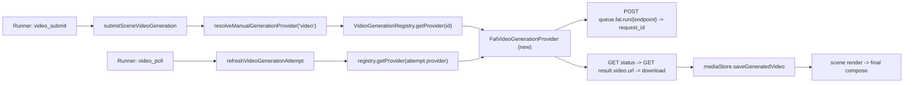

# P35 FAL.ai Video Provider Readiness — Recon

Status: RECON ONLY. No application code, tests, schema, config, dependencies, MCP
tools or UI were changed. No commits or pushes. No paid provider calls were made;
no credential values were read, printed, logged or verified by real requests. The
~$50 FAL.ai reserve is untouched. All existing tracked files and all untracked
recon reports were preserved.

Baseline: branch `main`, HEAD `309f4ba` ("feat(production): add opt-in background
music to production runs"), == `origin/main`. Working tree clean apart from the
untracked recon reports `p29-text-overlays-kinetic-typography-recon.md`,
`p29.2-text-overlay-authoring-recon.md`, `p31-end-to-end-production-workflow-recon.md`,
`p33-music-production-run-recon.md`.

Evidence tags used below: **Verified by test**, **Code-inspected**, **Official
doc (URL)**, **Unverified**, **Potential risk**.

Goal: determine how ready the existing video-generation pipeline is for a FAL.ai
integration as the preferred AI-video provider, pin the exact interface gaps,
recommend a concrete model/endpoint and a smallest-safe integration, and propose a
separately-approved small real-provider pilot (not executed here).

---

## 1. Executive summary and verdict

The application already has a **provider-neutral video abstraction** (submit →
poll → download → store → render) with a real OpenAI adapter (contract unverified
per `p28-real-provider-readiness-recon.md`) and a fake/local adapter. FAL.ai fits
that abstraction well: it is an asynchronous queue with `request_id` + status +
result endpoints and a `video.url` output, which maps cleanly onto
`VideoGenerationProvider.submit/getStatus/download`.

Verdict: **FAL.ai is a good, low-risk fit and should be integrated as a new
adapter behind the existing `VideoGenerationProvider` interface — not as a second
pipeline.** Readiness gaps are small and localized:

- **Gap A — provider id plumbing.** `VideoRunProvider = 'local' | 'openai'`
  (`lib/production/run-types.ts:7`) and `GenerationProvider = 'openai' | 'gemini' |
  'local' | 'other'` (`lib/types/generation.ts:3`). A `fal` provider id must be
  added to both, to `parseVideoProvider`, `isRealProvider`, `resolveProviderDefaults`,
  `normalizeProviderNameForGeneration`, `assertRunPolicyPreflight`, and the
  registry. Without this, an interrupted FAL job becomes `provider:'other'` and
  cannot be resumed by `video_poll` (`run-recovery.ts:301-314` + `run-policy.ts:410-418`).
- **Gap B — job-id/endpoint coupling.** `getStatus`/`download` receive only
  `providerJobId` (`provider.ts:58-59`), but FAL URLs are
  `https://queue.fal.run/{endpoint_id}/requests/{request_id}`. Because the registry
  returns a **new provider instance per call** (`registry.ts:15-21`) and the poll
  path does not pass `model`, the adapter cannot rely on instance state. The
  endpoint id must be deterministic from construction config (env), or encoded in
  a composite `providerJobId`.
- **Gap C — no request timeout.** Like the OpenAI video adapter, the pipeline has
  no per-request timeout; a FAL adapter should own an `AbortController` deadline
  (the music adapter is the in-repo precedent).
- **Gap D — reference semantics.** FAL image-to-video wants `start_image_url`;
  the pipeline marks every reference `role:'reference'`
  (`video-generation-service.ts:188`) and never `'start_frame'`. Phase 1 should
  use text-to-video to avoid image hosting; image-to-video needs small plumbing.

No architectural change, no new job store, no webhook infrastructure is required
for a first integration: the existing submit/poll loop already handles async
`queued`/`generating` jobs.

Recommended first model: **`minimax/h3-max-turbo/text-to-video`** at **$0.025 /
second** (confirmed schema + pricing) — a 5 s clip ≈ $0.125, so a controlled pilot
costs cents, not dollars. See §5.

---

## 2. Existing video pipeline map

### 2.1 Interface (`lib/ai/video-generation/provider.ts`)

- `VideoGenerationProvider` (`:54-61`): `providerId`, `getCapabilities()`,
  `submit(request)`, `getStatus(providerJobId)`, `download(providerJobId)`,
  optional `cancel?`.
- `VideoGenerationRequest` (`:12-21`): `model?`, `prompt`, `references?`
  (`VideoReferenceInput` = `{ id, mimeType, data: Buffer, filename?, role?:
  'reference'|'start_frame' }`), `aspectRatio?`, `width?`, `height?`,
  `durationSeconds?`, `metadata?`.
- `VideoGenerationCapabilities` (`:23-31`): `supportsTextToVideo`,
  `supportsImageToVideo`, `supportsReferences`, `maxReferences?`,
  `supportedAspectRatios?`, `supportedDurationsSeconds?`, `supportsCancellation`.
- `VideoGenerationSubmission` (`:33-38`): `providerJobId`,
  `status: 'queued'|'generating'`, `providerStatus?`, `metadata?`.
- `VideoGenerationStatusResult` (`:40-46`): `status: GenerationStatus`,
  `providerStatus?`, `errorCode?`, `errorMessage?`, `metadata?`.
- `VideoGenerationDownload` (`:48-52`): `mimeType`, `data: Buffer`, `metadata?`.
- `VideoGenerationProviderError` (`:63-72`): `{ status, code: GenerationErrorCode }`.

`GenerationStatus = 'planned'|'queued'|'generating'|'generated'|'failed'|'rejected'`
(`lib/types/generation.ts:7`); `GenerationErrorCode` (`:9-20`) includes
`NOT_CONFIGURED`, `INVALID_REQUEST`, `UNSUPPORTED`, `REFERENCE_ERROR`,
`PROVIDER_AUTH`, `PROVIDER_RATE_LIMIT`, `PROVIDER_REJECTED`, `PROVIDER_FAILED`,
`DOWNLOAD_FAILED`, `MEDIA_INVALID`, `INTERNAL`.

### 2.2 Registry and adapters (`lib/ai/video-generation/`)

- `registry.ts:7` `VideoProviderId = 'openai' | 'fake'`. `getProvider`
  (`:14-24`): `'openai'` → `new OpenAiVideoGenerationProvider()`; `'fake'|'local'`
  → `new FakeVideoGenerationProvider()`; else throws
  `VideoGenerationProviderError(..., 400, 'INVALID_REQUEST')`. **Constructs a fresh
  instance per call.** `getVideoGenerationConfigurationStatus()` (`:31-36`) returns
  `{ openaiConfigured: Boolean(process.env.OPENAI_API_KEY), defaultProvider }`.
- `fake-provider.ts`: in-memory `JOBS` (`:14`); `FAKE_MP4_BYTES` = 24-byte
  non-decodable stub (`:15`); capabilities text+image-to-video, references max 8,
  aspects 16:9/1:1/9:16, durations [4,5,6,8,10], no cancel (`:20-30`); submit id
  `fake-video-job-<sha1(prompt,10)>-<ts>` (`:38`); a prompt containing `fail`
  forces a failure scenario (`:39`,`:64-77`). Poll steps: 1→queued, 2→generating,
  3+→generated (`:79-91`).
- `openai-provider.ts`: `providerId='openai'`; options `{ apiKey?, model?, baseUrl? }`,
  defaults `process.env.OPENAI_API_KEY`, `OPENAI_VIDEO_MODEL || 'sora-1'`,
  `https://api.openai.com/v1` (`:57-61`); `normalizeProviderStatus` (`:29-48`);
  `mapAspectRatio` accepts 16:9/9:16/1:1 else `UNSUPPORTED` (`:19-27`); submit
  `POST /videos/generations` (`:98`), status `GET /videos/generations/{id}` (`:127`),
  download re-reads status then fetches `output.url` (`:150-183`). **Untested; the
  endpoint/model contract is unverified** (`p28-real-provider-readiness-recon.md:38,67,167`).

### 2.3 Service (`lib/generation/video-generation-service.ts`)

- `submitSceneVideoGeneration(projectId, sceneId, { regenerate?, provider?, mode? }, deps)`
  (`:226-386`): per-scene submit lock (`:16`,`:232-237`); guards already-generated
  (`:251-253`), active job (`:255-257`), empty prompt (`:259-261`);
  `assertGenerationTransition` (`:263`); resolves provider via
  `resolveVideoProvider` → `resolveManualGenerationProvider('video', ...)`
  (`:148-157`); resolves references from `scene.referenceIds` (`:170-193`); persists
  a `queued` attempt **before** calling `provider.submit` (`:272-304`); on submit
  success persists `providerJobId`/`providerStatus` (`:352-372`); on submit failure
  marks the attempt `failed` and preserves the previous asset (`:320-350`).
- `refreshVideoGenerationAttempt(projectId, attemptId, deps, { mode? })`
  (`:388-612`): per-attempt poll lock (`:17`,`:394-399`); returns persisted state
  for historical/non-active attempts (`:414-445`); requires `providerJobId` for
  active attempts (`:447-449`); resolves provider from **`attempt.provider`**
  (`:451-452`); on `status==='generated'` downloads and stores a new asset
  (`:508-545`), on `failed`/`rejected` falls back to the previous asset
  (`:558-565`); status-call failure marks the attempt `failed` (`:457-488`).
- `normalizeProviderNameForGeneration` (`:31-45`): `openai→openai`,
  `gemini→gemini`, `fake|local→local`, **else `other`**. A `fal` id would map to
  `other` today (Gap A).
- Storage: `mediaStore.saveGeneratedVideo` (`lib/storage/media-store.ts:312-351`)
  derives the extension from the **provider-reported MIME**
  (`webm|mov|mp4`), probes metadata via ffprobe, returns an `Asset`
  (`type:'video'`, `provenance:'generated'`) carrying `providerJobId`/
  `providerRequestId` in metadata.

### 2.4 HTTP surfaces

- Submit: `app/api/projects/[id]/scenes/[sceneId]/generate-video/route.ts`
  (`POST`, body `{ regenerate? }`, throttled `generate_video`).
- Poll: `app/api/projects/[id]/generation-jobs/[attemptId]/route.ts`
  (`GET`, throttled `video_poll`).
- Both call the service with **no provider/mode**, so they use the server default
  (`mock`/`local` unless `PRODUCTION_RUN_ALLOW_REAL_PROVIDERS`).

### 2.5 Production-run integration (`lib/production/`)

- Planner (`production-planner.ts:201-266`): emits `video_submit` (scene prompt)
  and, when a job is active, `video_poll` with `payload.attemptId`.
- Executor (`run-service.ts:899-969`): `video_submit` → `submitVideo(projectId,
  sceneId, { regenerate, provider: providers.video, mode })`; `video_poll` →
  `pollVideo(projectId, attemptId, undefined, { mode })`.
- Policy (`run-policy.ts`): `resolveProviderDefaults` (`:98-114`) real video =
  `openai`; `parseVideoProvider` (`:126-134`) accepts only `local|openai`;
  `isRealProvider` (`:156-158`) = `openai|elevenlabs`; `assertRunPolicyPreflight`
  (`:322-446`) enforces mode/provider + `OPENAI_API_KEY` for video, and requires a
  `video_poll` action's attempt provider to equal `policy.providers.video`
  (`:410-440`); `resolveManualGenerationProvider` (`:532-599`) normalizes a single
  modality and asserts credentials.
- Recovery (`run-recovery.ts:43-195`): an active video attempt with `providerJobId`
  is left for polling (`:60-65`); without one it is failed and, in real mode, the
  `video_submit` action id is suppressed so it is not re-billed (`:94-96`).
- Durable run store/registry preserve `acceptedConfig.policy` including
  `providers` (`run-registry.ts:339-353`); the runner's default video concurrency
  is submit 2 / poll 4 (`run-service.ts:139-140`).

### 2.6 Consumption (render → compose)

`sceneRenderService.renderScene` normalizes the scene (fake stubs are
non-decodable, see §3) and `videoCompositionService.composeProject` concatenates
the normalized clips. Regardless of which provider produced the bytes, the path is
identical once a decodable MP4 asset is stored, so **no compositor change is
needed** for FAL.

### 2.7 Test inventory (video-relevant)

| File | Kind | Notes |
| --- | --- | --- |
| `tests/video-provider-registry.test.ts` | unit | resolves openai/local, unknown throws, config status default `local`. |
| `tests/video-generation-service.test.ts` | unit | mocked store/media + a stub provider; submit/poll/failure/historical paths. **Does not import any real adapter.** |
| `tests/video-compositor-args.test.ts` | unit (pure) | FFmpeg arg construction incl. music mix. |
| `tests/video-composition-plan.test.ts` | unit | composition plan from scenes/assets. |
| `tests/video-composition-service.integration.test.ts` | real FFmpeg | composes fabricated renders; **guard skips if ffmpeg missing**. |
| `tests/video-compositor-audio.integration.test.ts` | real FFmpeg | audio safety (single stereo track, `alimiter`). |
| `tests/production-run-e2e.integration.test.ts` | real FFmpeg + fake providers | full mock run incl. video fake/submit + music. |
| `tests/run-policy.test.ts`, `tests/run-recovery.test.ts`, `tests/production-planner.test.ts`, `tests/production-run-service.test.ts` | unit | policy/recovery/planner/run lifecycle. |

Gaps: **no test imports `OpenAiVideoGenerationProvider` or
`FakeVideoGenerationProvider` directly** (the fake is only exercised through the
service stub/registry). No test proves provider bytes → real media store → render.
FFmpeg-based tests only assert audio-stream counts/args, which the 24-byte fake
stub cannot satisfy (those tests fabricate real clips).

---

## 3. FAL.ai findings (official documentation)

Primary sources (fetched during this recon):

- Queue API: https://docs.fal.ai/model-endpoints/queue
  (redirects to https://fal.ai/docs/documentation/model-apis/inference/queue)
- Client + `FAL_KEY`: https://docs.fal.ai/clients/javascript
- Pricing: https://fal.ai/pricing
- Model schemas: https://fal.ai/models/minimax/h3-max-turbo/text-to-video/api ,
  https://fal.ai/models/bytedance/seedance-2.5/text-to-video/api ,
  https://fal.ai/models/fal-ai/kling-video/v3/pro/image-to-video/api

### 3.1 Authentication and transport (Official doc)

- API key via `FAL_KEY` environment variable, sent as **`Authorization: Key $FAL_KEY`**
  (note: `Key`, not `Bearer`). Server-side Node/TS uses `@fal-ai/client`, but the
  raw REST API is fully usable with `fetch`.
- Hosted models use a persistent queue at `https://queue.fal.run/{model_id}`.

### 3.2 Queue lifecycle (Official doc)

| FAL status | Maps to pipeline `VideoGenerationStatusResult.status` |
| --- | --- |
| `IN_QUEUE` | `queued` (surface `queue_position`) |
| `IN_PROGRESS` | `generating` (surface `logs`) |
| `COMPLETED` | `generated` **if result has no error**, else `failed` (`error`/`error_type`) |

Endpoints:

- Submit: `POST https://queue.fal.run/{model_id}` → `{ request_id, response_url,
  status_url, cancel_url, queue_position }`.
- Status: `GET https://queue.fal.run/{model_id}/requests/{request_id}/status?logs=1`.
- Result: `GET https://queue.fal.run/{model_id}/requests/{request_id}` →
  model-specific JSON; **video models return a `video` object** with a `url`.
- Cancel: `PUT .../requests/{request_id}/cancel` → `202 CANCELLATION_REQUESTED` /
  `400 ALREADY_COMPLETED` / `404 NOT_FOUND`.
- Streaming (SSE): `.../status/stream`. Webhooks: submit with `?fal_webhook=<url>`
  or `webhookUrl`; POST payload `{ request_id, status: "OK"|"ERROR", payload }`.
- Media URLs (`https://v3.fal.media/...`) are public but **expire**; download
  promptly. Retries: FAL auto-retries server-error/timeout/rate-limit up to 10
  times (same request, not a new charge); disable with `X-Fal-No-Retry: 1`.
  `start_timeout` (`X-Fal-Request-Start-Timeout`) caps queue wait.

### 3.3 Candidate models and pricing (Official doc)

Pricing table (https://fal.ai/pricing, video section, at recon time):

| Model / endpoint | Unit | Price |
| --- | --- | --- |
| `minimax/h3-max/text-to-video`, `.../image-to-video`, `.../reference-to-video` | second | $0.05 |
| `minimax/h3-max-turbo/text-to-video`, `.../image-to-video` | second | **$0.025** |
| `fal-ai/kling-video/v2.5-turbo/pro/image-to-video` | second | $0.07 |
| `fal-ai/kling-video/v3/pro/image-to-video`, `.../text-to-video` | second | $0.14 list ($0.112 audio-off / $0.168 audio-on per model page) |
| `bytedance/seedance-2.0/image-to-video`, `.../reference-to-video` | 1000 tokens | $0.014 |

Schema highlights:

- **`minimax/h3-max-turbo/text-to-video`** (recommended phase-1): input `prompt`
  (required), `duration` (float seconds, default 5), `resolution` enum
  `480P|768P|1080P` (default `768P`), `aspect_ratio` enum
  `21:9|16:9|4:3|1:1|3:4|9:16` (default `16:9`), `seed`, `enable_safety_checker`,
  `prompt_expansion_mode` (`disabled|balanced|quality`), `target_audio_url`,
  `sync_mode`. Output `{ video: { url, content_type, file_name, file_size },
  expanded_prompt?, timings? }`.
- **`bytedance/seedance-2.5/text-to-video`**: input `prompt`, `resolution`
  (`480p|720p|1080p`), `duration` (`auto`|4–30), `aspect_ratio` (`auto`|`21:9|16:9|
  4:3|1:1|3:4|9:16`), `generate_audio` (default true), `bitrate_mode`, `codec`,
  `end_user_id`. Output `{ video: { url }, seed, draft_id? }`. Pricing not listed
  in the top-10 table (Unverified).
- **`fal-ai/kling-video/v3/pro/image-to-video`**: input `start_image_url`
  (**required**), `prompt` (required if no `multi_prompt`), `duration` string enum
  `3..15`, `generate_audio` (default true), `end_image_url`, `elements`,
  `negative_prompt`, `cfg_scale`, `multi_prompt`. Output `{ video: { url,
  content_type, file_name, file_size } }`. **Aspect ratio is inferred from the
  start image** (the `aspect_ratio` field is ignored); default concurrency **1 per
  user**.

Reminder: model names and prices above are as shown on the live pages at recon
time and can change; re-verify before the pilot.

---

## 4. Fit and gap analysis

What maps cleanly:

- Async `queued`/`generating`/`generated` maps 1:1 to FAL `IN_QUEUE`/`IN_PROGRESS`/
  `COMPLETED`.
- `request_id` is a natural `providerJobId`; the existing durable attempt record
  already persists and reuses it across restarts.
- `download` → fetch `result.video.url` (public, no auth) → Buffer → existing
  `saveGeneratedVideo` (MIME `video/mp4`).
- Mock-mode safety, per-scene/attempt locks, run-level duplicate suppression, and
  real-mode `video_submit` suppression on ambiguous recovery all already apply.

Concrete mismatches to close (all localized):

1. **Provider id (`fal`)** — add to `VideoRunProvider`, `GenerationProvider`,
   `parseVideoProvider`, `isRealProvider`, `resolveProviderDefaults` (real default
   could remain `openai` or become configurable), `assertRunPolicyPreflight`
   (accept `fal` as a real provider + require `FAL_KEY`),
   `normalizeProviderNameForGeneration` (map `fal→fal`), and the registry
   (`getProvider('fal') → new FalVideoGenerationProvider()`, plus
   `falConfigured: Boolean(process.env.FAL_KEY)` in the config-status fn).
   **Highest-value change**: without the normalization/recovery mapping, a FAL
   `video_poll` cannot resume after a restart (`run-policy.ts:410-418` throws
   `INVALID_POLICY` for an unresolved attempt provider).
2. **Endpoint resolution for `getStatus`/`download`** — the adapter only gets
   `providerJobId`. Options:
   - (Phase 1, simplest) deterministic endpoint from config:
     `FAL_VIDEO_ENDPOINT` (default `minimax/h3-max-turbo/text-to-video`); the
     adapter builds all URLs from it and ignores `request.model`.
   - (Robust) composite job id `fal:{endpoint_id}:{request_id}`, parsed by the
     adapter. Recommended if per-scene models are ever needed.
3. **Timeout** — add an `AbortController` + deadline (submit/status/download),
   mirroring `lib/ai/music/elevenlabs-provider.ts`.
4. **References / image-to-video** — FAL accepts HTTP(S) URLs or base64 data URIs.
   Phase 1 (text-to-video) ignores `references`. Phase 2 maps the first
   `role:'start_frame'` reference (or `references[0]`) to `start_image_url` as a
   `data:{mime};base64,{...}` URI (no server-side hosting needed); requires the
   service to mark a start frame or the adapter to treat `references[0]` as start.
5. **Duration/aspect mapping** — snap `durationSeconds` to the model's supported
   set and validate `aspectRatio` against `supportedAspectRatios` (throw
   `UNSUPPORTED`, matching the OpenAI adapter). Kling i2v ignores aspect.

---

## 5. Recommended first model and cost

| | Phase 1 smoke | Phase 2 (explainer fit) |
| --- | --- | --- |
| Endpoint | `minimax/h3-max-turbo/text-to-video` | `minimax/h3-max-turbo/image-to-video` or `fal-ai/kling-video/v3/pro/image-to-video` |
| Mode | text-to-video | image-to-video (start frame) |
| Price | $0.025 / s | $0.025 / s (H3 Turbo) or $0.112–0.168 / s (Kling v3 pro) |
| 5 s cost | ~$0.125 | ~$0.125 (H3 Turbo) / ~$0.56–0.84 (Kling) |
| Rationale | No image hosting/plumbing; confirmed schema + pricing; cheap enough to fail safely | Matches "generate still, then animate" explainer workflow |

Budget (existing ~$50 reserve): Phase 1 at ~$0.125/5 s would allow ~400 clips;
even a generous Phases 1–2 pilot of 5–10 short clips is well under **$5**. No
pilot should exceed a small explicit cap (proposed: 10 requests / $5).

---

## 6. Proposed integration (smallest safe) — not built here

1. **Adapter** `lib/ai/video-generation/fal-provider.ts` implementing
   `VideoGenerationProvider` (`providerId='fal'`): constructor reads
   `FAL_KEY` (existence only), `FAL_VIDEO_ENDPOINT` (default H3 Max Turbo T2V),
   `FAL_VIDEO_BASE_URL` (`https://queue.fal.run`), and a timeout. `submit` builds
   the FAL input, `POST`s, returns `{ providerJobId: request_id, status: 'queued' }`.
   `getStatus` maps FAL status (incl. `error`/`error_type` → typed error).
   `download` fetches the result, then the `video.url`, returns a Buffer with
   `content_type || 'video/mp4'`. Wrap errors into `VideoGenerationProviderError`
   (`401/403→PROVIDER_AUTH`, `429→PROVIDER_RATE_LIMIT`, other `4xx→PROVIDER_REJECTED`
   or `INVALID_REQUEST`, `5xx→PROVIDER_FAILED`, bad output → `DOWNLOAD_FAILED`).
   Never log the key or echo raw provider payloads beyond `error.message`.
2. **Registry/config**: `getProvider('fal')`; `falConfigured` in the status fn.
3. **Policy/types**: add `fal` everywhere listed in §4.1; preflight requires
   `FAL_KEY` when `providers.video==='fal'` in real mode; mock mode still only
   allows `local`.
4. **No changes** to the service, storage, runner, planner, compositor, MCP, UI,
   or the music/TTS/image paths, beyond the enum/parse wiring.
5. **Config surface** (`.env.example` placeholders, values user-supplied):
   `FAL_KEY=`, `FAL_VIDEO_ENDPOINT=minimax/h3-max-turbo/text-to-video`,
   `FAL_VIDEO_TIMEOUT_MS=...`.

Safety invariants (must hold):

- Mock mode can never reach FAL: `fal` is rejected by `assertRunPolicyPreflight`
  and `resolveManualGenerationProvider` before any request is built; the fake
  adapter has no network code.
- Real FAL requires `mode:'real'` **and** `PRODUCTION_RUN_ALLOW_REAL_PROVIDERS`
  **and** `FAL_KEY`. No silent fallback.
- Tests use an injected mock provider/`fetch`; they never touch the real account.
- A possibly-accepted paid job is never blindly resubmitted: recovery already
  suppresses `video_submit` when an active attempt has no `providerJobId`
  (`run-recovery.ts:94-96`). Composite job id (§4.2) should be persisted in the
  queued attempt **before** submit returns, minimizing the orphan window.
- Provider ids/costs/status diagnosable from run events; run log sanitizer
  (`run-registry.ts:28-54`) already redacts `Bearer`/`sk-` patterns — extend it to
  redact `Key <token>` if FAL errors could echo the header.

---

## 7. Risks and mitigations

- **Orphaned paid job on crash between FAL accept and `providerJobId` persist**
  (tiny window): mitigation = persist a deterministic/composite id, never
  resubmit on recovery, and treat missing-id real attempts as failed.
  **Potential risk.**
- **Endpoint/job-id coupling** (Gap B): wrong endpoint in `getStatus` → 404 as
  `INVALID_REQUEST`/`PROVIDER_REJECTED`. Mitigation = deterministic env endpoint
  or composite id. **Potential risk.**
- **Duration/aspect unsupported values**: FAL models reject or silently clamp;
  mitigation = capability-based validation + `UNSUPPORTED`. **Potential risk.**
- **FAL concurrency (Kling i2v default 1/user)**: many scene submits queue; the
  runner's `video_submit` concurrency should not be raised for FAL.
  **Code-inspected / Unverified.**
- **Media expiration**: results must be downloaded during the `COMPLETED` poll;
  the current flow already downloads immediately on `generated`.
  **Official doc.**
- **Non-determinism**: some FAL models expose `seed`; capture it in metadata for
  reproducibility where available. **Official doc.**
- **Fake stub remains non-decodable** (`fake-provider.ts:15`) — unrelated to FAL
  but means mock-mode video still cannot render; FAL real output must be validated
  end-to-end by the pilot, not by mock tests. **Code-inspected.**
- **Provider-neutrality preserved**: FAL is an adapter behind the existing
  interface; no second pipeline, no new job store. **Design decision.**

---

## 8. Test and acceptance plan

Unit (mock, no network):

1. `FalVideoGenerationProvider` with injected `fetch`: submit → `request_id` →
   `providerJobId`; status `IN_QUEUE`/`IN_PROGRESS`/`COMPLETED` mapping; `COMPLETED`
   with `error` → `failed`; `download` fetches result then `video.url`; 401/429/5xx
   → typed `PROVIDER_AUTH`/`PROVIDER_RATE_LIMIT`/`PROVIDER_FAILED`; missing key →
   `NOT_CONFIGURED`; timeout aborts.
2. Registry resolves `fal`; config status reports `falConfigured`.
3. Policy: `fal` accepted as real provider with `FAL_KEY`; rejected in mock mode;
   rejected in real mode without `FAL_KEY`; `video_poll` provider matching works
   for `fal`; `normalizeProviderNameForGeneration('fal')==='fal'`; recovery resumes
   a `fal` job by `providerJobId`.
4. Service/integration: extend `tests/production-run-e2e.integration.test.ts` or a
   sibling with a **mock** FAL adapter emitting a real decodable MP4 fixture, and
   assert the submit→poll→store→render→compose chain (mirrors the existing fake
   run).

Acceptance (proposed):

- Mock mode: zero FAL network calls; existing tests unchanged.
- Real mode + `FAL_KEY`: exactly the configured number of FAL requests; no retries
  beyond FAL's own; no duplicate submits.
- Stored asset: `type:'video'`, MIME `video/mp4`, non-zero dims, `providerJobId`
  recorded.
- The compose step produces a playable MP4.
- No secret value ever appears in logs or responses.

---

## 9. Real-provider pilot proposal (requires separate approval — do not run)

Mirror the existing fail-closed pilot pattern
(`lib/ai/image-generation/real-image-pilot.ts`, `real-narration-pilot.ts`):

- Gates (all required, default off): `RUN_REAL_FAL_VIDEO_PILOT=1`,
  `CONFIRM_REAL_FAL_VIDEO_PILOT=YES`, `FAL_KEY` present,
  `PRODUCTION_RUN_ALLOW_REAL_PROVIDERS=true`.
- Scope: **one** project, **one** `generated_video` scene, **one** request, model
  `minimax/h3-max-turbo/text-to-video`, `duration=5`, `resolution=480P` (cheapest),
  no batch, no retry.
- Budget cap: 1 request / well under $1 (expected ≈ $0.125).
- Success = one real FAL request, decodable MP4 persisted by the real media store,
  consumed by scene render and final compose; typed error surface on failure; no
  secret leakage.
- No real-provider tests in CI; the pilot is a manually-run, gated smoke.

---

## 10. Files and functions supporting the findings

- Interface/types: `lib/ai/video-generation/provider.ts`; `lib/types/generation.ts`
  (`:3`,`:7`,`:9-20`,`:63-65`); `lib/production/run-types.ts:4-16`.
- Registry/adapters: `lib/ai/video-generation/registry.ts`,
  `video-generation/{fake-provider.ts,openai-provider.ts}`.
- Service/storage: `lib/generation/video-generation-service.ts`;
  `lib/storage/media-store.ts:312-351`.
- Routes: `app/api/projects/[id]/scenes/[sceneId]/generate-video/route.ts`;
  `app/api/projects/[id]/generation-jobs/[attemptId]/route.ts`.
- Run pipeline: `lib/production/{production-planner.ts,production-runner.ts,run-service.ts,run-policy.ts,run-recovery.ts,run-registry.ts,run-types.ts}`;
  `app/api/projects/[id]/production-runs/route.ts`.
- Pilot precedent: `lib/ai/image-generation/real-image-pilot.ts`.
- Prior recon: `p28-real-provider-readiness-recon.md` (video = least ready;
  OpenAI video contract unverified).
- Tests: `tests/video-provider-registry.test.ts`,
  `tests/video-generation-service.test.ts`, `tests/video-composition-plan.test.ts`,
  `tests/video-composition-service.integration.test.ts`,
  `tests/video-compositor-args.test.ts`,
  `tests/video-compositor-audio.integration.test.ts`,
  `tests/production-run-e2e.integration.test.ts`, `tests/run-policy.test.ts`,
  `tests/run-recovery.test.ts`, `tests/production-planner.test.ts`.

---

## 11. Git status and controls

- Branch `main`; HEAD `309f4ba` (unchanged, == `origin/main`).
- No tracked files modified; no commits or pushes.
- No paid/real provider calls; no credential values read, printed or verified.
- No FAL.ai request was made; the ~$50 reserve is untouched.
- Untracked preserved: `p29-text-overlays-kinetic-typography-recon.md`,
  `p29.2-text-overlay-authoring-recon.md`,
  `p31-end-to-end-production-workflow-recon.md`,
  `p33-music-production-run-recon.md`, and this new
  `p35-fal-video-provider-readiness-recon.md`.
- Controls honored: recon only; no product/test/schema/config/dependency changes;
  provider-neutral architecture preserved (FAL proposed strictly as an adapter
  behind the existing `VideoGenerationProvider` interface).
