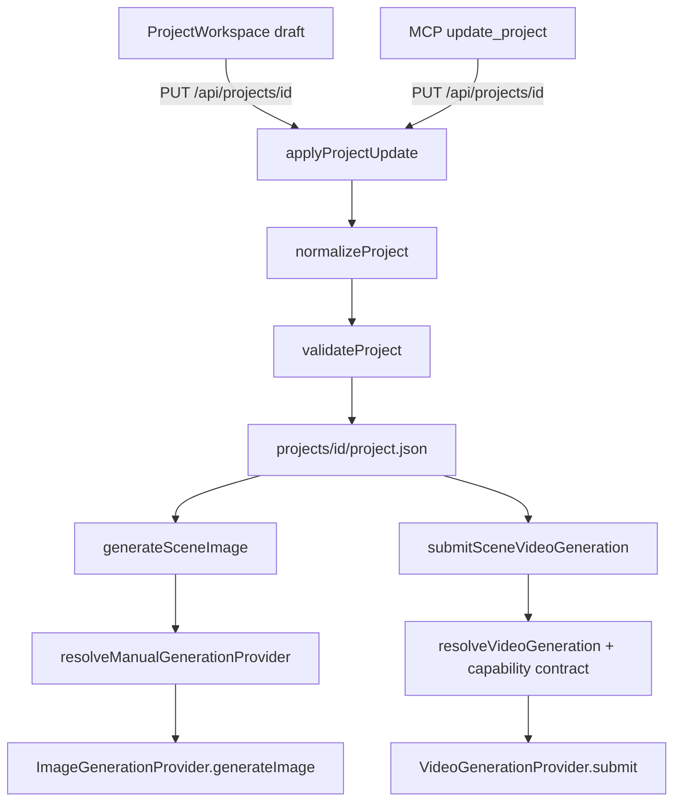

# P405 - Project Bible & Prompt Compiler Recon

Recon only. Geen productiecode gewijzigd, geen migratie, geen nieuwe UI, geen
wijzigingen aan rendering/montage/timing/QC/composition fingerprints, geen commit
en geen push. Er zijn geen betaalde provider-calls gedaan en geen externe
generatiejobs gestart. Alle probes gebruikten lokale fixtures en de fake providers.

Inspectiedatum: 2026-10-27. Branch: `261021-feat-motion-canvas-animation-mcp`.
HEAD: `6609da8` (`chore(docs): move root phase notes into devdocs`), gelijk aan
`origin/main`. Working tree schoon.

Methode: code-inspectie van projectmodel, normalisatie, validatie, generatie-
services, provider-adapters, productieplanner/-runner, approval-hashing,
fingerprints, opslag en MCP/REST-paden; plus kleine, read-only `tsx`-probes tegen
de bestaande pure functies (`normalizeProject`, `applyProjectUpdate`,
`validateProject`, `hashProductionContent`, `getReferenceUsage`) om gedrag te
bevestigen. Geen probe schrijft naar `projects/`.

Bestaande tests (niet-destructief, opnieuw gedraaid):
`tests/human-approval-hash.test.ts`, `tests/project-update.test.ts`,
`tests/p2-domain.test.ts`, `tests/fal-video-service.test.ts` - 4 files,
43 tests, alles groen.

Oordeel: **haalbaar in kleine stappen**. De kleinste bruikbare architectuur is een
pure prompt-compiler vóór de bestaande provider-resolver, met een optionele,
getypeerde Bible op projectniveau. Zonder Bible/entiteiten moet de compiler de
opgeslagen prompt byte-for-byte doorgeven, zodat bestaande projecten, mock-hashes,
approval-hashes en fingerprints identiek blijven. Twee bestaande defecten
(reference-set verlies bij opslaan, en ontbrekende approval-dekking) moeten eerst
worden meegenomen, anders is elke entiteitslaag niet betrouwbaar.

---

## 1. Wat er feitelijk is onderzocht

| Onderdeel | Bestanden |
| --- | --- |
| Project- en scenemodel | `lib/types/render.ts`, `lib/types/scene.ts`, `lib/types/generation.ts`, `lib/types/reference.ts`, `lib/types/asset.ts`, `lib/types/explainer.ts` |
| Normalisatie en patchsemantiek | `lib/projects/normalize-project.ts`, `lib/projects/project-update.ts`, `lib/projects/project-patch-shape.ts`, `lib/projects/explainer-normalization.ts` |
| Validatie | `lib/validation/project-validation.ts` |
| Promptinvoer en generatie | `lib/generation/image-generation-service.ts`, `lib/generation/video-generation-service.ts`, `lib/generation/presenter-service.ts`, `lib/generation/stock-image-service.ts` |
| Provider-adapters en capabilities | `lib/ai/video-generation/*`, `lib/ai/image-generation/*` |
| Productie/planning | `lib/production/production-planner.ts`, `lib/production/run-service.ts`, `lib/production/run-policy.ts` |
| Approval en fingerprints | `lib/explainer/human-approval.ts`, `lib/render/render-fingerprint.ts`, `lib/render/video-composition-service.ts` |
| Opslag | `lib/storage/project-store.ts`, `lib/storage/media-store.ts`, `lib/projects/usage.ts` |
| Interfaces | `app/api/projects/[id]/route.ts`, `app/api/projects/[id]/references/route.ts`, `app/api/projects/[id]/scenes/[sceneId]/generate-{image,video}/route.ts`, `mcp/authoring/tools.ts`, `mcp/read-only/*` |

---

## 2. Architectuur zoals die nu is

### 2.1 Waar prompttekst vandaan komt

Er is precies **een** bron van generatieve prompttekst per scène:

```text
Scene.visual.generation.prompt        (verplicht, niet-leeg bij submit)
Scene.visual.generation.negativePrompt (optioneel, alleen image)
Scene.visual.generation.referenceIds  (optioneel)
Scene.referenceIds                    (fallback / effectieve set)
```

Bevestigd in de services:

- `lib/generation/image-generation-service.ts:321-329` bouwt
  `ImageGenerationRequest` uit `current.prompt`, `current.negativePrompt`,
  `current.model`, `current.aspectRatio` en de gelezen referentiebytes.
- `lib/generation/video-generation-service.ts:427-445` geeft `current.prompt`
  ongewijzigd door aan `resolveVideoGeneration(...)`.

Alle andere "rijke" velden zijn **niet** verbonden met generatie:

| Veld | Waar het leeft | Wordt het een provider-prompt? |
| --- | --- | --- |
| `explainer.brief.{topic,goal,audience,tone}` | `lib/types/explainer.ts` | Nee. Alleen validatie (`project-validation.ts:323-326`) en workflowstatus/UI. |
| `explainer.story.*` en `beats` | idem | Nee. Alleen intent-planning en approval-hash. |
| `SceneIntentDraft.visualIntent` | `lib/types/explainer.ts` | Nee. Wordt bij materialisatie als tekst in `Scene.notes` gezet (`lib/explainer/scene-intent-materializer.ts:34-44,85`). |
| `Scene.notes` | `lib/types/scene.ts` | Nee. Geen enkele generatie- of renderservice leest het. |
| `Project.description` | `lib/types/render.ts` | Nee. Geen promptgebruik gevonden. |
| `graphic.prompt` | `lib/types/scene.ts` | Nee. Renderer gebruikt alleen `template`/`templateData`/`style`; `prompt` komt alleen in de approval-hash voor (`lib/explainer/human-approval.ts:80-89`). |
| `renderSettings.graphicStyle` | `lib/types/render.ts` | Nee. Alleen voor graphic/SVG-rendering (`lib/render/scene-resolver.ts:215`). |
| `stock_image.query` | `lib/types/scene.ts` | Nee, dat is een stockzoekopdracht (`lib/generation/stock-image-service.ts:276-301`). |

Er bestaat **geen** LLM-scriptgenerator in de repo: `ScriptGenerator` in
`lib/types/ai.ts:40-42` is ongebruikt, en er is nergens een chat/LLM-call. Alle
context is dus auteurstekst; een compiler moet deterministisch en puur zijn.

### 2.2 Dataflow bij generatie



Belangrijk: de UI houdt een lokale `draft`; opslaan gaat via `PUT` en de server
normaliseert en valideert. De MCP-patch is een vrije `z.record` (`mcp/authoring/tools.ts:27`),
dus onbekende sleutels bereiken `applyProjectUpdate` en worden daar
**shallow** samengevoegd (`lib/projects/project-update.ts:60`).

### 2.3 Normalisatie is selectief, niet generiek

`normalizeProject` (`lib/projects/normalize-project.ts:481-520`) bouwt
`renderSettings` expliciet op met een whitelist van velden
(`aspectRatio, fps, width, height, fit, background, audio, subtitlesEnabled, seed,
logo, graphicStyle, studio`). `normalizeScene` (`:387-407`) bouwt de scène ook
expliciet op met een vaste set velden. Gevolg, empirisch bevestigd:

- Onbekende **top-level** projectvelden overleven (de `...project` spread).
- Onbekende **scènevelden** worden stilzwijgend gedropt.
- Onbekende **renderSettings**-velden worden gedropt.
- `generation.metadata` (`Record<string, unknown>`) overleeft wel.
- `reference.metadata` (`Record<string, string|number|boolean|null|undefined>`)
  overleeft, dus geneste objecten daarin overleven alleen als тип-compatible waarde.

`validateProject` wijst onbekende velden niet af; het valideert alleen bekende
velden. Een Bible op projectniveau zou dus nu al "blijven plakken", maar zonder
schema, zonder normalisatie en zonder validatie - niet acceptabel voor iets dat
paid generation aanstuurt.

### 2.4 Provider-adapters en waar beperkingen worden afgehandeld

| Provider | Modus | Referenties | Aspect | Duur | Promptvertaling in adapter |
| --- | --- | --- | --- | --- | --- |
| `openai` image | image | `image[]` bij `images/edits` | size-map per model (`openai-provider.ts:24-45`) | n.v.t. | `negativePrompt` wordt aan de prompt geplakt (`:180`) |
| `fake` image | image | geteld in metadata | n.v.t. | n.v.t. | geen; prompt-hash bepaalt kleur (`fake-provider.ts:9`) |
| `openai` video | text/image/reference | max 8, rollen `reference|start_frame|end_frame` (`openai-provider.ts:77-86`) | 16:9, 1:1, 9:16 | vrij | referenties als base64 met rol (`:98-110`) |
| `fal` text-to-video | text | **0**; elke referentie is `REFERENCE_ERROR` (`fal-provider.ts:441-448`) | 16:9, 1:1, 9:16 | 1-15 s | `prompt_expansion_mode`, `resolution`, `enable_safety_checker` (`:418-462`) |
| `fal` image-to-video | image | alleen start/end keyframes (`:337-379`) | geen (canvas volgt frame) | 1-15 s | `image_url` / `end_image_url` als data-URI (`:429-440`) |
| `fake` video | alle | max 8 | 16:9, 1:1, 9:16 | vrij | prompt-hash bepaalt job (`fake-provider.ts:36`) |

De **centrale** validatie voor video zit in
`lib/ai/video-generation/capabilities.ts:149-...`: modusclassificatie, max
referenties, rolconflicten, aspectratio en duur. Die draait vóór submit
(`lib/generation/video-generation-service.ts:427`), dus vóór de betaalde call.

Voor **image** bestaat zo'n capability-contract niet. `generateSceneImage` heeft
geen maximum op het aantal referenties en geen provider/model-validatie behalve
de providerkeuze (`lib/generation/image-generation-service.ts:192-202`).

Conclusie: provider-specifieke vertaling is al redelijk geïsoleerd in de
adapters. Wat ontbreekt is de **generieke** laag daarvoor: er is geen object dat
"de bedoelde prompt" representeert los van "wat deze provider aankan".

### 2.5 Opslag en identiteit van referenties

- Referenties zijn `ReferenceImage` met `id`, `name`, `description`, `filePath`,
  `tags[]`, `metadata{}` (`lib/types/reference.ts:1-10`).
- Bestanden staan onder `projects/{id}/references/` en worden via
  `mediaStore.saveReference` geschreven (`lib/storage/media-store.ts:242-270`).
- Uploads accepteren png/jpg/jpeg/webp, max 25 MB
  (`app/api/projects/[id]/references/route.ts:13-20,80-150`).
- Verwijderen is beschermd via `getReferenceUsage`
  (`lib/storage/project-store.ts:920-939`).
- `getReferenceUsage` kijkt **alleen** naar `scene.referenceIds`
  (`lib/projects/usage.ts:44-48`).

Dit laatste is een concreet probleem voor entiteiten, zie F3.

### 2.6 Approval en fingerprints

`hashProductionContent` (`lib/explainer/human-approval.ts:131-162`) dekt:

- alle scene-intents (incl. `visualIntent`, `notes`, timing),
- per scène: `id, order, duration, type, narrationText, narrationVoiceId,
  narrationModel, visual` (`:118-129`),
- `visualFingerprint` (`:42-96`): voor generated image/video alleen
  `prompt`, `model`, `provider`,
- muziek (`prompt`, `assetId`),
- presenter (`enabled`, `provider`, `maxCostUsd`).

Empirisch bevestigd met probes:

| Wijziging | Approval wordt stale? |
| --- | --- |
| `generation.prompt` | ja |
| `generation.negativePrompt` | **nee** |
| `generation.referenceIds` / `scene.referenceIds` | **nee** |
| `scene.notes` | **nee** |
| `scene.overlay` | **nee** |
| `scene.duration` | ja |
| hypothetisch `project.bible` / `project.entities` | **nee** |
| `title` / `updatedAt` | nee (by design, test `human-approval-hash.test.ts:139-146`) |

Render- en compositiefingerprints:

- `createSceneRenderFingerprint` (`lib/render/render-fingerprint.ts:3-...`) bevat
  bron, motion, transition, overlay, logo, compositie en karaoke-woorden. Geen
  prompt en geen referenties.
- Compositie-`inputFingerprint` (`lib/render/video-composition-service.ts:361-...`)
  bevat per scène `{sceneId, renderId, narrationSignature}`, plus audio/muziek/
  presenter. Geen prompt.

Dat is consistent: de gerenderde asset is het artefact; promptwijzigingen maken
een scène pas "stale" nadat opnieuw is gegenereerd. Een prompt-compiler mag dit
daarom **niet** aanraken.

---

## 3. Bevindingen

### F1 - De prompt is een platte string; alle context is dood gewicht

`Scene.notes`, `visualIntent`, `brief` en `description` zijn auteurstekst die
nergens in een provider-request terechtkomt. Er is dus geen bestaande
"promptopbouw" om op voort te bouwen: er is één string per scène. Een compiler
moet die string als **basislaag** behandelen, niet als iets dat al samengesteld is.

### F2 - Onbekende scènevelden worden stil gedropt

`normalizeScene` bouwt een expliciet object. Een `scene.entityIds`,
`scene.shot`, `scene.compiledPrompt` of `scene.bibleRef` verdwijnt bij de eerste
save. Top-level `bible`/`entities` overleven wel (spread), maar zijn dan
ongetypeerd en ongeldig te gebruiken als bron van waarheid.

Dit betekent: nieuwe scenebindingen vereisen een echte modeluitbreiding plus
normalisatie, niet alleen "er een sleutel bij zetten".

### F3 - `generation.referenceIds` wordt overschreven door `scene.referenceIds`

`normalize-project.ts:160` zet `const referenceIds = scene.referenceIds ?? []` en
gebruikt diezelfde lijst voor `generation.referenceIds` (`:217`, `:250`, `:306`).
Empirisch:

- `scene.referenceIds = ['scene-ref']` en
  `generation.referenceIds = ['gen-ref']` -> na normalisatie is
  `generation.referenceIds === ['scene-ref']`.
- `scene.referenceIds = []` en `generation.referenceIds = ['start','end']` met
  keyframes -> na normalisatie is `generation.referenceIds === []`, terwijl
  `startFrameReferenceId`/`endFrameReferenceId` blijven staan.

De services kiezen de effectieve set als
`generation.referenceIds.length > 0 ? generation.referenceIds : scene.referenceIds`
(`image-generation-service.ts:256`, `video-generation-service.ts:419`). Na een
gewone save is de keyframe dus **niet** meer in de effectieve set, en
`assertFrameReferences` (`video-generation-service.ts:201-221`) zal de submit
afwijzen met `generation.reference.startFrameInvalid`.

Dit is vandaag al een bug, maar het wordt blokkerend zodra entiteiten of
per-scène referentieplanning op `generation.referenceIds` leunen.

### F4 - Verwijderbescherming kent alleen `scene.referenceIds`

`getReferenceUsage` negeert `generation.referenceIds` en keyframes. Een
referentie die alleen door een generatie wordt gebruikt, kan worden verwijderd;
het bestand gaat weg en de id blijft dangling in het generatierecord. Validatie
controleert die id vervolgens tegen een inmiddels lege referentielijst
(`project-validation.ts:432-436`), dus de fout verschijnt pas bij submit of
helemaal niet.

### F5 - Approval dekt de prompt, maar niet de context die de prompt bepaalt

Zodra de Bible of entiteiten de prompt beïnvloeden, kan een real/paid run een
andere prompt gebruiken dan de goedgekeurde snapshot. Vandaag dekt de hash alleen
`prompt/model/provider`; `negativePrompt`, `referenceIds`, `notes`, `overlay` en
een toekomstige Bible vallen erbuiten. Dat is een fail-open gat voor paid werk.

### F6 - Provider-capabilities zijn ongelijk verdeeld over image en video

Video heeft een centraal contract; image niet. Voor een compiler die
referentiebeelden en negatieve instructies wil doorgeven, is dat asymmetrisch:
dezelfde "entity reference" kan bij video netjes worden gevalideerd en bij image
ongemerkt te veel of ongeldige input opleveren.

### F7 - Negatieve instructies hebben geen provider-neutraal kanaal

Alleen de OpenAI-image-adapter gebruikt `negativePrompt`, en doet dat door tekst
aan de positieve prompt te plakken (`:180`). Video-adapters hebben geen negatief
veld. Een Bible met "negative instructions" moet dus als **apart** veld blijven
bestaan en per adapter vertaald worden; niet vooraf in de prompt worden gerold.

### F8 - Er is geen shot/camera-model

`MotionPreset` is render-side (zoom/pan). Er is geen veld voor camera-actie of
shotgrootte in de generatie-intentie. `visualIntent` is vrije tekst in een intent,
niet in de scène. Een compiler kan camera-actie dus alleen uit bestaande
auteurstekst halen, tenzij we een klein gestructureerd shot-veld toevoegen.

### F9 - Er is geen continuïteitsmechanisme

Er is geen verwijzing naar vorige/volgende scène in generatie, geen "laatste frame
van scène N", geen gedeelde referentie per locatie/character. `resolveNeighborSceneId`
(`lib/workspace/scene-navigation.ts`) is puur UI-navigatie. `scene.renders[]`
bevat wel per-scène MP4's, maar er is geen pijplijn die daar een frame uit haalt.

### F10 - Determinisme is een harde randvoorwaarde

De fake providers hashen de prompt (`fake-provider.ts:9,36`). Elke wijziging in
spaties, volgorde of toegevoegde tekst verandert mock-output en bestaande
testsnapshots. De default (geen Bible/entiteiten) moet daarom exact
passthrough zijn, niet "opnieuw geformatteerd".

### F11 - Patch-merge is shallow; een Bible zou ongemerkt half overschreven worden

`applyProjectUpdate` doet `{...existing, ...incoming}` (`:60`). Een patch met
alleen `bible.lighting` vervangt de hele Bible (empirisch bevestigd). Dat is voor
een Bible met meerdere dimensies (palette, lighting, camera, mood, negatives)
riskant. Ofwel de Bible moet als één atomair object worden behandeld (documenteer
dat expliciet), of er moet een expliciete mergefunctie komen.

### F12 - Geen promptlengte- of tokenbudget

Alleen muziek heeft een limiet (`MAX_MUSIC_PROMPT_LENGTH = 2000`,
`lib/ai/music/elevenlabs-provider.ts:42`). Image/video-promptlimieten zijn niet
in code vastgelegd. Een compiler die Bible + entiteiten + context toevoegt, moet
dus zelf een app-budget en truncation-beleid hebben, met diagnostics in plaats
van stil knippen.

---

## 4. Project Bible - voorstel

### 4.1 Vorm

Eén optioneel, getypeerd object op projectniveau:

```ts
interface ProjectBible {
  version: 1;
  // Korte, promptbare stijlzin; dit is de enige vrije "look & feel"-tekst.
  visualStyle?: string;
  palette?: string[];            // hex-kleuren, volgorde = prioriteit
  lighting?: string;
  mood?: string;
  camera?: {
    defaultShot?: 'wide' | 'medium' | 'close' | 'macro' | 'aerial';
    defaultMovement?: 'static' | 'push_in' | 'pull_out' | 'pan_left' | 'pan_right' | 'handheld';
    lens?: string;               // bv. "35mm", "85mm", "anamorphic"
  };
  negativeInstructions?: string[]; // nooit in de positieve prompt rollen
  // Optionele, expliciete modelvoorkeuren per modaliteit. Geen policy-vervanging.
  defaults?: {
    imageModel?: string;
    videoModel?: string;
  };
  notes?: string;                // auteurstekst, nooit automatisch prompten
}
```

`Project.bible?: ProjectBible` (top-level, niet in `renderSettings`; F2/F11).

### 4.2 Compatibiliteit

- `bible` afwezig -> compiler doet niets extra; prompt blijft exact gelijk (F10).
- `bible` aanwezig maar leeg -> normalisatie laat het veld weg (geen lege
  objecten opslaan), dus geen gedragswijziging.
- Geen migratie: bestaande `project.json`-bestanden blijven geldig; normalisatie
  vult `undefined` aan.
- `renderSettings.graphicStyle` blijft de bron voor **grafische** kleuren. De
  Bible-palette is voor generatieve beelden/video en mag daar niet stilzwijgend
  in worden gemerged; hooguit als expliciete fallback bij het aanmaken van een
  nieuwe `graphicStyle`, en dat is een UI-beslissing, geen rendernaam.

### 4.3 Waarom niet in `explainer` of `renderSettings`

- `explainer` is story/intent/approval-domein; de Bible geldt voor alle
  visualisaties, ook buiten de explainerflow.
- `renderSettings` wordt ge-whitelist en beïnvloedt rendering; de Bible mag
  rendering niet raken (buiten scope).

---

## 5. Entity References - voorstel

### 5.1 Hergebruik van bestaande opslag

Entiteiten verwijzen naar bestaande `ReferenceImage.id`'s. Geen nieuwe
bestandsstructuur, geen kopiëren van bytes:

```ts
type EntityRole = 'character' | 'product' | 'location' | 'prop';

interface ProjectEntity {
  id: string;                       // createId('entity')
  role: EntityRole;
  name: string;
  aliases?: string[];
  description?: string;             // korte, promptbare identiteit
  referenceIds: string[];           // bestaande ReferenceImage-ids, volgorde = prioriteit
  // Alleen relevant als de provider referenties aankan; anders advisory.
  lockAppearance?: boolean;
  metadata?: Record<string, string | number | boolean | null | undefined>;
}
```

`Project.entities?: ProjectEntity[]`.

Scènebinding: `Scene.entityIds?: string[]`. Dat veld moet **echt** in
`normalizeScene` en in `Scene` worden opgenomen (F2), met validatie dat elke id
bestaat en dat `referenceIds` van de entiteit bestaan.

### 5.2 Meerdere referentiebeelden per entiteit

`referenceIds: string[]` met deterministische volgorde. De compiler kiest, per
provider, de eerste N die de provider aankan (zie 6.4). Geen impliciete
sortering op `createdAt`, want dat maakt output onvoorspelbaar.

### 5.3 Verwijderbescherming

`getReferenceUsage` moet worden uitgebreid met:

1. `scene.referenceIds`,
2. `scene.visual.generation.referenceIds`,
3. `startFrameReferenceId` / `endFrameReferenceId`,
4. `entity.referenceIds`.

Zonder (4) kan een entiteit een verdwenen bestand aanwijzen; zonder (2)/(3)
blijft F3/F4 bestaan.

### 5.4 Waarom geen `metadata`-bag als primaire opslag

`reference.metadata` en `generation.metadata` overleven normalisatie, dus een
"verstopte" entity-laag zou technisch kunnen. Dat is om drie redenen onverstandig:
geen validatie, onzichtbaar voor read-only MCP-projecties behalve als rauwe bag,
en geen duidelijke eigenaar van de waarheid. Gebruik `metadata` alleen voor
afgeleide diagnostiek (bv. `metadata.compiledFrom`), niet voor het model zelf.

---

## 6. Prompt Compiler - voorstel

### 6.1 Scheiding in twee stappen

```text
[1] GENERIEK COMPILEREN (puur, geen netwerk)
    Bible + Entities + Scene-instructies + Shot + ContinuityContext
        -> CompiledPrompt { positive, negative, referencePlan, diagnostics, digest }

[2] PROVIDER BINDING (bestaande laag)
    CompiledPrompt + provider capabilities
        -> ImageGenerationRequest | VideoGenerationRequest
        -> bestaande resolver/capability-contract
```

Stap 1 weet niets van OpenAI/FAL. Stap 2 weet niets van Bible/entiteiten.

### 6.2 Uitvoertype

```ts
interface CompiledPromptSegment {
  source: 'scene' | 'bible' | 'entity' | 'shot' | 'continuity';
  text: string;
}

interface CompiledPromptReference {
  referenceId: string;
  role: 'reference' | 'start_frame' | 'end_frame';
  source: 'scene' | 'entity' | 'continuity';
  entityId?: string;
}

interface CompiledPrompt {
  positive: string;                 // exacte providerinvoer (na join)
  negative?: string;                // apart gehouden (F7)
  segments: CompiledPromptSegment[];
  references: CompiledPromptReference[];
  diagnostics: Array<{ code: string; severity: 'info' | 'warning' | 'error'; message: string }>;
  digest: string;                   // sha256 over segments + references + relevante instellingen
  passthrough: boolean;             // true als er geen Bible/entiteiten/continuity waren
}
```

`digest` is voor audit en regeneratie, niet voor render- of
compositiefingerprints.

### 6.3 Opbouwvolgorde (generiek)

1. **Scene-instructie**: `generation.prompt`, exact zoals opgeslagen. Dit is de
   basis en bepaalt de eerste regel.
2. **Shot/camera-actie** (indien aanwezig als gestructureerd veld): één korte
   zin, bv. "Camera: slow push-in, 35mm." Nog niet bestaand als veld (F8); in
   fase 1 alleen als expliciete opt-in.
3. **Entity-identiteit**: per gebonden entiteit één regel met `name` +
   `description` + eventueel `aliases`. Geen namen verzinnen; alleen wat de
   auteur vastlegt.
4. **Bible-stijl**: `visualStyle`, `lighting`, `mood`, `palette`,
   `camera`-defaults, als één compacte stijlregel. Niet herhalen wat al in de
   scèneprompt staat (dedupe op genormaliseerde zin).
5. **Continuïteitscontext**: alleen advisory tekst (zie 8).
6. **Negatives**: nooit in `positive`; als aparte `negative`-string.

De join is deterministisch: vaste volgorde, vaste scheiding (`\n\n`), geen
sortering op datum.

### 6.4 Referentieplanning en providerbeperkingen

De compiler levert een **gewenst** referentieplan; de bestaande
capability-laag beslist wat mag.

| Situatie | Gedrag |
| --- | --- |
| Geen Bible/entiteiten | `passthrough: true`; `positive === generation.prompt`; zelfde referentieset als nu |
| Entiteit met `lockAppearance: true`, provider kan geen referenties aan (FAL t2v) | **error** vóór submit; nooit stilzwijgend tekst-only |
| Entiteit zonder lock, provider kan geen referenties aan | downgrade naar tekst met `diagnostic code=prompt.reference.degraded`, expliciet in diagnostics en attempt-metadata |
| Meer referenties dan `maxReferences` | error met code `prompt.reference.maxExceeded` (niet stil knippen) |
| Keyframes | altijd rol `start_frame`/`end_frame`, nooit `reference`; slechts één per rol |
| Image-provider | gebruik een app-breed maximum (voorstel: 8, gelijk aan video) tot een providerlimiet aantoonbaar is; documenteer dit als app-policy |

Waarom strikt: FAL t2v weigert referenties met een harde fout. Een stille
downgrade zou betekenen dat een betaalde generatie een ander personage oplevert
dan bedoeld. `lockAppearance` maakt die verwachting expliciet.

### 6.5 Budget en truncation

- Zachte limiet: één instelbare `MAX_COMPILED_PROMPT_CHARS` (voorstel 4000, ruim
  onder wat de adapters aankunnen; muziek gebruikt 2000 als precedent).
- Overschrijding: error bij `lockAppearance`/expliciete Bible, anders warning +
  deterministische truncation van **laag 4 en 5** (Bible/continuity), nooit van
  laag 1 (de scène-instructie).
- Diagnostics gaan mee in attempt-metadata, niet in het projectdocument.

### 6.6 Waar de compiler wordt aangeroepen

Vóór elke betaalde of externe stap:

- `lib/generation/image-generation-service.ts`: na `assertGenerationTransition`
  en vóór `assertAndReservePaidSubmit`/provider-call; vervang
  `current.prompt`/`current.negativePrompt` in de request door
  `compiled.positive`/`compiled.negative`.
- `lib/generation/video-generation-service.ts`: direct vóór
  `resolveVideoGeneration(...)`; zo faalt een compile-error vóór de
  capability-resolve en vóór de paid-submit-reservering.
- Productie: geen aparte compiler-call nodig; `run-service` roept dezelfde
  services aan. De planner blijft alleen naar `generation.prompt.trim()` kijken
  (`production-planner.ts:113-118,230,282`), dus "ready" verandert niet.
- Niet in render/compositie: daar is geen prompt.

### 6.7 Wat wordt opgeslagen

- Het projectdocument blijft de **auteursbron**: `generation.prompt` wordt niet
  overschreven met de gecompileerde tekst (geen migratie, geen verrassingen).
- Het generatierecord/attempt krijgt auditinformatie in
  `generation.metadata`, dat normalisatie overleeft:
  `compiledPrompt`, `compiledDigest`, `compiledFrom` (bible-versie,
  entity-ids), `promptDiagnostics`.
- Bij regenerate moet de compiler opnieuw draaien vanuit de **huidige**
  projectstaat, niet de opgeslagen gecompileerde tekst hergebruiken. Dat houdt
  Bible-wijzigingen zichtbaar in de approval-hash (zie 9).

---

## 7. Providervertaling - expliciete scheiding

De compiler levert generieke input; de adapters vertalen:

- OpenAI image: `negative` -> `\n\nNegative prompt: ...` (bestaand gedrag, `:180`).
- OpenAI video: referenties met rollen; geen negatief veld, dus negatives blijven
  ongebruikt tenzij een adapter expliciet een tekstuele "Avoid:"-regel toevoegt.
  Dat is een **gedragswijziging** en moet opt-in zijn, niet de default.
- FAL t2v: referenties weigeren; `prompt_expansion_mode` blijft zoals nu.
- FAL i2v: alleen keyframes; aspectratio vervalt.
- Fake providers: prompt-hash; passthrough moet exact zijn (F10).

Nieuwe regel: geen enkele adapter mag `CompiledPrompt.segments` herordenen of
stilzwijgend segmenten weglaten; alleen de capability-laag mag een expliciete
error of een gedocumenteerde downgrade geven.

---

## 8. Continuïteit - wat kan wel en wat niet

### 8.1 Onderscheid

- **Gewenste continuïteit (advisory)**: tekstuele context, bv. "zelfde locatie als
  de vorige scène", "zelfde outfit", kleurpalet, eerder gebruikte entiteit.
  Een model kan dit negeren. Nooit als garantie presenteren.
- **Harde garantie (afdwingbaar)**: hetzelfde referentiebeeld wordt daadwerkelijk
  meegestuurd naar een provider die referenties ondersteunt, of de keyframe is
  exact het aangewezen beeld. Ook dan is de output niet gegarandeerd identiek;
  alleen de input is gegarandeerd.

### 8.2 Beschikbare bouwstenen

- Entiteit-`referenceIds` (zelfde persoon/product/locatie in meerdere scènes).
- `startFrameReferenceId` / `endFrameReferenceId` met een bestaand
  referentiebeeld (geen frame-extractie nodig).
- `scene.source.beatIds` / `sceneIntentId` als structurele, niet-visuele
  koppeling.
- `scene.renders[]` bevat render-artefacten, maar er is geen frame-extractie en
  geen ffmpeg-stap in de generatiepijplijn; dat toevoegen is een aparte,
  duurdere fase en valt buiten de kleinste architectuur.

### 8.3 Voorstel

Fase 1: geen automatische buurcontext. Wel een expliciet, optioneel
`continuity`-blok per scène (of per Bible) dat de auteur vult:
`sameAsSceneId`, `sameLocationAsEntityId`, `sameWardrobeAsEntityId`. De compiler
zet dit om in advisory tekst en, waar mogelijk, in hetzelfde entiteit-
referentiebeeld. Diagnostics maken zichtbaar of het advisory of hard is.

Fase 2 (indien nodig): "laatste frame van vorige render als start_frame". Vereist
ffmpeg-frame-extractie, een nieuwe asset en expliciete kosten/performance-keuzes;
bewust niet in de kleinste implementatie.

---

## 9. Veiligheid en kosten

- De compiler is een pure functie: geen `fetch`, geen credentials, geen
  filesystem-writes. Referentiebytes worden pas in de bestaande
  `resolveReferenceInputs` gelezen, zoals nu.
- De compiler draait vóór `assertRealExecutionAuthorized`,
  `assertAndReservePaidSubmit` en vóór elke provider-call; een compile-error
  kost dus niets.
- Geen betaalde calls in deze recon; alle probes gebruikten lokale objecten.
- **Approval-uitbreiding is verplicht** voordat de Bible/entiteiten de prompt
  mogen beïnvloeden. Voorstel: neem in `hashProductionContent` op:
  - `project.bible` (genormaliseerd),
  - `project.entities` (id, role, referenceIds, description, lockAppearance),
  - per scène: `entityIds`, `negativePrompt`, `referenceIds`,
  - de **compiled digest** per scène (zodat een compiler-versie- of
    Bible-wijziging de approval stalt).
 Dit is geen renderfingerprint-wijziging; het is het bestaande
  approval-contract voor paid werk.
- Bestaande projecten hebben geen `humanApproval` (geverifieerd in
  `projects/*/project.json`), dus deze uitbreiding breekt geen bestaande
  approvals. Toekomstige approvals worden strenger; dat is de bedoeling.

---

## 10. Kleinste bruikbare architectuur

### 10.1 Nieuwe pure module

`lib/generation/prompt/`:

- `types.ts` - `CompiledPrompt`, `CompiledPromptSegment`, diagnostics.
- `bible.ts` - normalisatie/validatie van `ProjectBible`.
- `entities.ts` - resolutie van `Scene.entityIds` -> entiteiten -> referenties.
- `compile.ts` - `compileScenePrompt({ project, scene, providerHint? })`.
- `budget.ts` - charbudget, dedupe, deterministische truncation.

Geen React, geen opslag, geen netwerk.

### 10.2 Model- en validatie-uitbreidingen (minimaal)

1. `lib/types/render.ts`: `bible?`, `entities?`.
2. `lib/types/scene.ts`: `entityIds?`, optioneel `shot?`.
3. `lib/projects/normalize-project.ts`: normaliseer de nieuwe velden expliciet;
   behoud `generation.referenceIds` (fix F3).
4. `lib/projects/project-patch-shape.ts`: structurele checks voor `bible`,
   `entities`, `scene.entityIds`.
5. `lib/validation/project-validation.ts`: geldige hexkleuren, rolwaarden,
   bestaande `referenceIds`, `entityIds` -> bestaande entiteit, geen dubbele
   entity-ids, `lockAppearance` alleen bij providers die referenties aankunnen
   (waarschuwing, geen blokkade, want providerkeuze kan later wijzigen).
6. `lib/projects/usage.ts`: uitbreiden met generatie-referenties, keyframes en
   entity-referenties (F3/F4).
7. `lib/explainer/human-approval.ts`: uitbreiden zoals in 9.

### 10.3 Integratiepunten in bestaande code

| Punt | Bestand:regel | Wijziging |
| --- | --- | --- |
| Image submit | `lib/generation/image-generation-service.ts:321-329` | compile -> request-velden |
| Video submit | `lib/generation/video-generation-service.ts:427-445` | compile vóór resolve |
| Referentiegebruik | `lib/projects/usage.ts:44-48` | extra bronnen |
| Approval | `lib/explainer/human-approval.ts:118-162` | Bible/entities/reference/negative/digest |
| Patchshape | `lib/projects/project-patch-shape.ts:17-18,32-...` | bible/entities/entityIds |
| Normalisatie | `lib/projects/normalize-project.ts:160,217,250,306,387-407,481-520` | F3 + nieuwe velden |
| Validatie | `lib/validation/project-validation.ts:432-446,554-557,646-666` | entity- en referentiechecks |

Niet aanraken: `lib/render/*` (fingerprints), `lib/production/production-planner.ts`
(alleen prompt-aanwezigheid), timing/QC/compositie.

### 10.4 Wat expliciet ontbreekt en nog niet wordt gebouwd

- Geen UI voor Bible/entiteiten (buiten scope).
- Geen LLM die de Bible schrijft.
- Geen frame-extractie voor continuïteit.
- Geen provider-specifieke prompt-templates per model (alleen capability-grenzen).
- Geen automatische prompt-vertaling naar andere talen.

---

## 11. Gefaseerde implementatie met acceptatiecriteria

### Fase P405.1 - Bible + pass-through compiler (kleinste nuttige stap)

Scope: `ProjectBible`-type, normalisatie, validatie, pure compiler die Bible
voorbereidt, en **exacte passthrough** zonder Bible.

Acceptatiecriteria:

1. Project zonder `bible`/`entities`: `compiled.positive === scene.visual.generation.prompt`
   (stringgelijkheid) en `compiled.negative === generation.negativePrompt`.
2. `compiled.passthrough === true`; geen extra segmenten.
3. Fake image/video `providerRequestId` verandert niet voor bestaande fixtures
   (mock-determinisme, F10).
4. `hashProductionContent` verandert niet voor projecten zonder Bible.
5. `validateProject` keurt een Bible met ongeldige hexkleur/rol af met een
   specifieke errorcode; een lege Bible wordt niet opgeslagen.
6. `tsc --noEmit` en `npm run lint` clean; bestaande suite ongewijzigd groen.

### Fase P405.2 - Entities + referentie-integriteit

Scope: `ProjectEntity`, `Scene.entityIds`, usage-uitbreiding, fix F3
(`generation.referenceIds` behouden), approval-uitbreiding.

Acceptatiecriteria:

1. Save-roundtrip behoudt `generation.referenceIds` en keyframes (regressietest
   op `applyProjectUpdate`).
2. Verwijderen van een referentie die alleen in `generation.referenceIds` of een
   entiteit voorkomt, wordt geblokkeerd met `usageSceneIds`/entiteitgebruik.
3. Twee scènes die dezelfde entiteit binden, leveren dezelfde
   referentie-id's in `compiled.references` (deterministische volgorde).
4. FAL t2v + `lockAppearance: true` -> compile-error vóór `resolveVideoGeneration`;
   geen provider-call, geen paid reserve.
5. Approval wordt stale bij wijziging van `entityIds`, `entity.referenceIds` of
   `negativePrompt`.
6. Bestaande projecten zonder `entities` blijven byte-identiek in promptgedrag.

### Fase P405.3 - Continuity (advisory)

Scope: expliciet continuity-blok, advisory tekst, diagnostics.

Acceptatiecriteria:

1. Continuity zonder referentie levert alleen tekst op met
   `diagnostic code=continuity.advisory`.
2. Continuity met een bestaand entiteit-referentiebeeld levert een harde
   referentie in `compiled.references` en een `continuity.hard`-diagnostic.
3. Geen wijziging aan render- of compositiefingerprints (aantoonbaar via
   bestaande fingerprinttests).
4. Geen frame-extractie, geen extra ffmpeg-pass.

### Fase P405.4 - Exposure (UI/MCP), pas na 1-3

Scope: `get_project` toont Bible/entities automatisch; `get_validation_report`
krijgt promptdiagnostics; `update_project` accepteert de nieuwe velden via het
bestaande patchpad. Geen nieuwe UI-tab vereist.

Acceptatiecriteria:

1. Read-only MCP `get_project` retourneert `bible`/`entities` ongewijzigd.
2. `update_project` met ongeldige Bible geeft `VALIDATION_FAILED` met
   padpecifieke errors.
3. Geen betaalde call nodig om de compiler te inspecteren (droog-run endpoint of
   pure functie-export).

---

## 12. Open vragen

1. Moet `bible.camera.defaultShot` ook `render.motion` beïnvloeden, of strikt
   gescheiden blijven (aanbevolen: gescheiden; rendering is buiten scope)?
2. Is een app-breed referentiemaximum van 8 voor image acceptabel, of moet dit
   per model configureerbaar zijn zodra een providerlimiet bekend is?
3. Moet een Bible-wijziging **altijd** approval stalen, ook als de scène
   `passthrough` is? Aanbevolen: ja, want de Bible is dan onderdeel van de
   goedgekeurde snapshot.
4. Willen we `negativeInstructions` voor video alsnog tekstueel meesturen
   (opt-in) of alleen voor image ondersteunen tot een provider een negatief veld
   heeft?
5. Moet `CompiledPrompt` ook op het generatie-**asset** worden bewaard
   (`Asset.generation`) voor reproduceerbaarheid, of is attempt-metadata genoeg?
   Aanbevolen: attempt-metadata nu, asset-trace later als regeneratie from asset
   een echte flow wordt.

---

## 13. Verificatie van deze recon

- `npx vitest run tests/human-approval-hash.test.ts tests/project-update.test.ts
  tests/p2-domain.test.ts tests/fal-video-service.test.ts`: 4 files, 43 tests,
  passed.
- Read-only probes met `npx tsx` (lokaal, geen netwerk, geen writes):
  - onbekende top-level velden overleven normalisatie; scène- en
    renderSettings-velden niet;
  - `generation.metadata` overleeft;
  - `generation.referenceIds` wordt overschreven door `scene.referenceIds`;
  - keyframes blijven staan terwijl hun referentie uit de effectieve set valt;
  - `getReferenceUsage` mist generatie- en keyframe-referenties;
  - approval wordt stale bij `prompt` en `duration`, niet bij
    `negativePrompt`, `referenceIds`, `notes`, `overlay`, `bible` of `entities`;
  - shallow patch vervangt een volledige Bible.
- Geen betaalde provider-calls, geen externe jobs, geen `projects/`-mutaties.

Stop na de recon.
